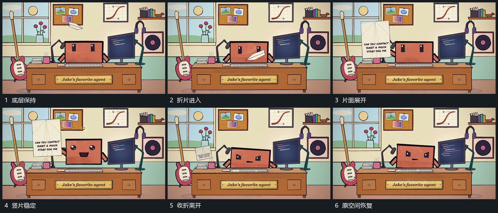

# 折叠薄片斜入展开成竖片再收折离开

## 运动指令

薄片以收折状态从侧上方斜入，经过主形上方时逐步打开折角并转成竖片。展开完成后片面短暂保持，内部短行补齐；随后收回折角，沿侧方飞离，底层始终保持。

## 视频切片

[播放本机制的原片切片](m02.mp4)

覆盖分镜中“底层保持”至“原空间恢复”的连续过程，并保留邻近的前后衔接画面；原片中交叠发生的动作一并保留。

## 分镜过程

## 组合与调整

可改变进出方向；展开与收折共享同一片面，不在中途换成另一张独立卡。
