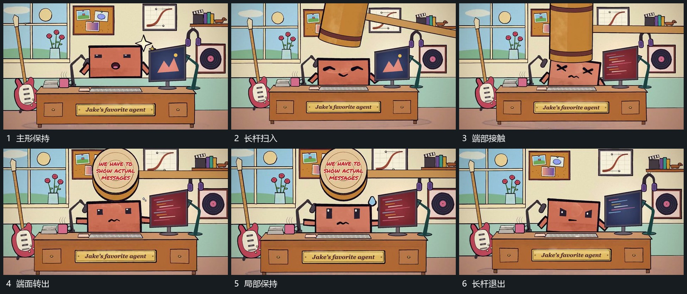

# 长杆端部下扫触及主形再转角露面退出

## 运动指令

从画面侧上方送入带大端部的长杆，杆身改变倾角，端部沿弧线向下扫到主形上方。接触时主形短暂压低，随后端部抬起并转角，使其正面短标可见；短暂保持后长杆退向边外。

## 视频切片

[播放本机制的原片切片](m03.mp4)

覆盖分镜中“主形保持”至“长杆退出”的连续过程，并保留邻近的前后衔接画面；原片中交叠发生的动作一并保留。

## 分镜过程

## 组合与调整

可缩小端部与压低幅度；接触与回升应连在同一摆动中，不分成两次无关联出现。
