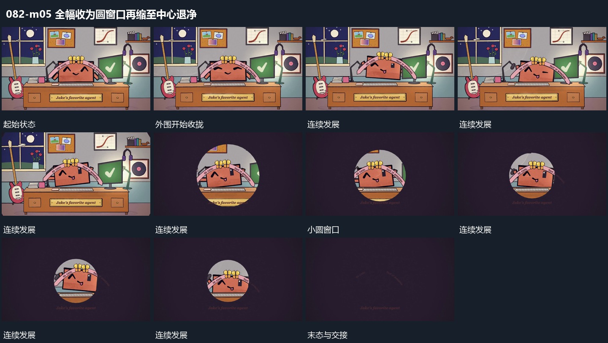

# 全幅收为圆窗口再缩至中心退净

## 运动指令

让外部空底从四周向中央收拢，只在圆形窗口中保留原空间。圆边界继续缩小，窗口内仍是原主形与底层的同一局部，直到窗口很小再退净。中央短行可在收拢后建立。

## 视频切片

[播放本机制的原片切片](m05.mp4)

覆盖分镜中“完整场面”至“窗口退净”的连续过程，并保留邻近的前后衔接画面；原片中交叠发生的动作一并保留。

## 分镜过程

## 组合与调整

需要接下一段时保留小圆作接点；窗口内不重新取另一幅无关图片。
