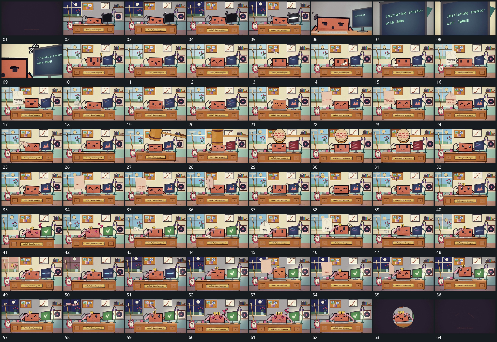

# 082｜原片运动总览

[观看完整原片](video.mp4)

## 运动总览

全片先在同一空间中用推向侧框并逐字填入后退回全貌推向侧框，框内短行逐字建立，再退回完整场面。多次复用折叠薄片斜入展开成竖片再收折离开，让折叠薄片斜向进入、展开为竖片、保持后再收折退出。

中段长杆端部下扫触及主形再转角露面退出把长杆端部向下扫到主形上方，再转角露出端面并退出。后续小片弧线落到上缘后长带顺势铺下让小片沿弧线落到主形上缘，长带顺势铺在原边界附近；第二次入场沿用同一接法。局部小形短暂向外漂动，最后全幅收为圆窗口再缩至中心退净收小圆窗口并退到空底。

## 完整运动段落

以下按原片中的出现顺序引用。建立、内部发展及完成反馈放在同一段中；同时发生的局部动作与运镜写在同一份指令里。不同段之间可以是连续接管，也可以是直接切换，不能仅凭条目相邻认定可直接拼接。重复出现的同类运动采用一次连续代表范围，切片不以逐段无缝覆盖整片为目标。

1. [推向侧框并逐字填入后退回全貌](mechanisms/m01.md)：局部推近填字退镜

2. [折叠薄片斜入展开成竖片再收折离开](mechanisms/m02.md)：斜入展开保持收折

3. [长杆端部下扫触及主形再转角露面退出](mechanisms/m03.md)：摆动下扫后转角

4. [小片弧线落到上缘后长带顺势铺下](mechanisms/m04.md)：弧线入场落定铺带

5. [全幅收为圆窗口再缩至中心退净](mechanisms/m05.md)：边界收拢窗口缩小

切片保留起始准备、必要内部停顿和完成或明确交接；首尾省略无新发展的等待，持续运动不要求人为停住。以上基于真实源帧序列和重点边界核对，不等同于全片连续声画审片。

## 完整64宫格

