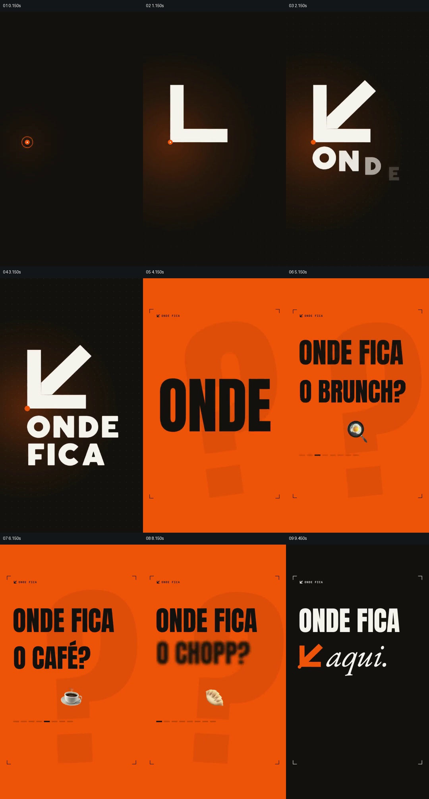

# 用同一提问轮换不同餐饮对象，再由品牌回应

- 作品：案例 026《餐饮数据、微型场景与手机展示》（库内索引名称）。
- 原片范围：00:00.000–00:10.000，含起点、不含终点；[完整原片](../video.mp4)｜[本卡片段](c01-20261111.mp4)。
- 范围依据：从品牌符号建立，到不同餐饮问题及“这里”的回应全部显露；10 秒开始数据段。
- 观察方式与未确认范围：查看整片 64 帧总览和本卡分镜。未独立完成连续原速观看与听审；抽帧之间的运动、停顿与声音配合待复核。画面中的界面、数字与说明是作品呈现，未经额外核实；设计价值为基于画面的分析。

## 原画面具体怎样设计

黑底中央从一个橙色小点开始，白色直角与斜线组成朝左下的箭头，下面排列“ONDE FICA”品牌名。画面随后变为橙色，背后有巨大的半透明问号，前景黑色大字反复出现“ONDE FICA”，下方对象依次换成早午餐、咖啡、寿司等，并配有对应的小食物图像。

橙底、问号和提问句式在每次变化时保持，改变的是具体对象和底部的小进度标记。到约 9.45 秒画面回到黑底，白色“ONDE FICA”旁出现橙色箭头和手写体“aqui.”，用“这里”回应前面的一组问题。

## 为什么这样设计，好在哪里

相同问句提供稳定的理解方式，替换餐饮对象则把服务覆盖的不同需求放进同一框架。最后复用开头箭头和品牌名作为回答，把连续问题收成一个明确入口；若只保留前面的几个问句而不保留回应，画面就缺少这项设计的结果。

## 可直接使用的创意指令

当一个入口可以解决多个相近问题时，先建立可辨认的共同身份，再用一致的提问结构依次放入不同的真实需求，为每项提供易辨认的小对象或素材。问题序列完成后，让此前建立的入口以明确文字或图形回应，形成完整的提问与答案。

品牌色、图标、问题数量和对象均可改变；保留同一问题结构与共同答案之间的关系，不能暗示服务能解决其未覆盖的需求。

本方法尚未在新题材中实测。
