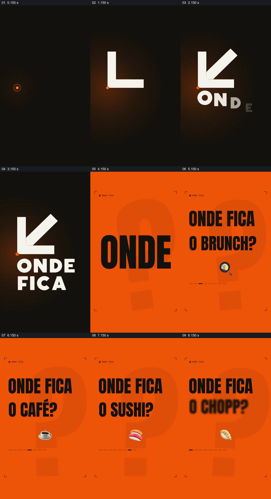

# 用同一句式连续提出不同聚餐问题

- 作品：案例 026《餐饮地点与社区数据》（索引名称）。
- 原片范围：00:00.000–00:09.000，含起点、不含终点；[完整原片](../video.mp4)｜[本卡片段](c01.mp4)。
- 观察方式：依据整片 64 宫格和约每秒一次的真实源帧观察，未连续原速观看或听审；声音、语气与完整播放节奏未确认。

## 原画面具体怎样设计

黑底箭头与 ONDE FICA 标识出现，随后橙色画面上一个大问号作为底层；前景依次显示关于约会、披萨和晚餐地点的问题，文字保持相似位置。

## 为什么这样设计，好在哪里

重复句式让观众先识别共同的问题，再通过替换具体场合感受问题覆盖的范围；大问号与高对比色为短促提问提供共同背景。

以上为依据画面的分析，非作者自述；预期观看效果未经观众测试。

## 可直接使用的创意指令

当多个日常情境共享同一种决策困难时，选取真实有代表性的几种场合，用相同句式和固定位置依次提出问题；保留一个共同的视觉符号，在问题建立后接入真实的解决路径。场合和措辞应适应目标观众。
