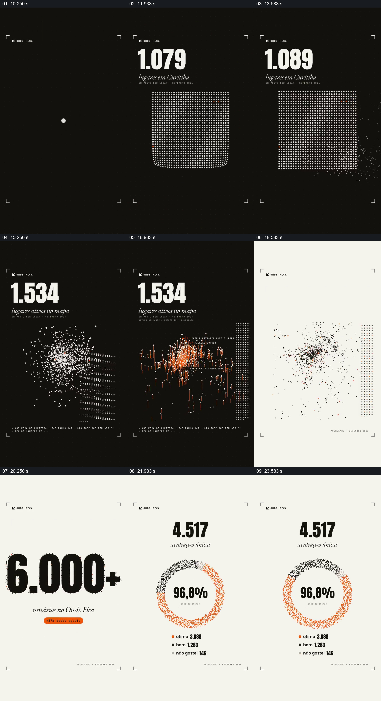

# 让点阵随统计变化并过渡到占比图

- 作品：案例 026《餐饮地点与社区数据》（索引名称）。
- 原片范围：00:10.000–00:25.000，含起点、不含终点；[完整原片](../video.mp4)｜[本卡片段](c02.mp4)。
- 观察方式：依据整片 64 宫格和约每秒一次的真实源帧观察，未连续原速观看或听审；声音、语气与完整播放节奏未确认。

## 原画面具体怎样设计

深色背景中数字从 101 增加到 1,534，小点由圆形发展成网格并散开；随后浅底出现“6.000+”，又转到“4.517”和环形点阵，中心写“96,8%”。

## 为什么这样设计，好在哪里

数字负责精确读数，点阵把规模变化转成可见的密度与范围，再以环形布局突出比例。各数字之间的口径与来源在抽帧中无法确认，不能据此视为真实统计。

以上为依据画面的分析，非作者自述；预期观看效果未经观众测试。

## 可直接使用的创意指令

当需要表现规模与组成时，先核定每个数值的单位、来源和统计时间；用点阵或其他图形表现数量变化，再在比例视图中清楚标注分子与分母。不同指标需要明确区分，装饰点数不必假装一一点对应。
