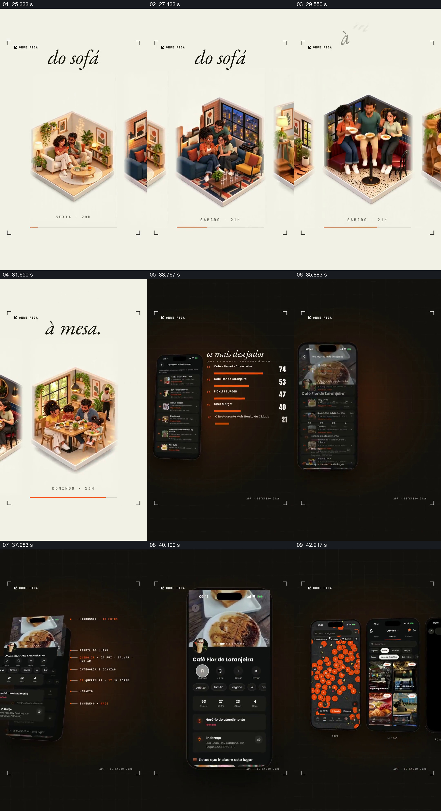

# 从微缩聚餐场景接到手机里的地点选择

- 作品：案例 026《餐饮地点与社区数据》（索引名称）。
- 原片范围：00:25.000–00:44.000，含起点、不含终点；[完整原片](../video.mp4)｜[本卡片段](c03.mp4)。
- 观察方式：依据整片 64 宫格和约每秒一次的真实源帧观察，未连续原速观看或听审；声音、语气与完整播放节奏未确认。

## 原画面具体怎样设计

浅色竖屏中多个小型室内场景依次移入：沙发旁聚会、多人围桌等，顶部文字从“do sofá”转到“à mesa”。随后深色画面出现手机列表与旁边的条形数字，接着展示餐厅详情、地图点位和更多手机页面。

## 为什么这样设计，好在哪里

先呈现人们可能发生的聚餐场合，再转向具体地点和地图，让界面展示有一个生活语境。画面中的列表、数量和地图点仅是产品演示，真实性与可用性未核实。

以上为依据画面的分析，非作者自述；预期观看效果未经观众测试。

## 可直接使用的创意指令

当介绍地点选择服务时，先选取与目标用户相关的实际活动情境，再展示如何从候选列表进入地点详情和地图；保留名称、位置等可核对字段，并用真实资料或清楚标注的模拟界面。场景插画可更换，但需与后续选择任务相连。
