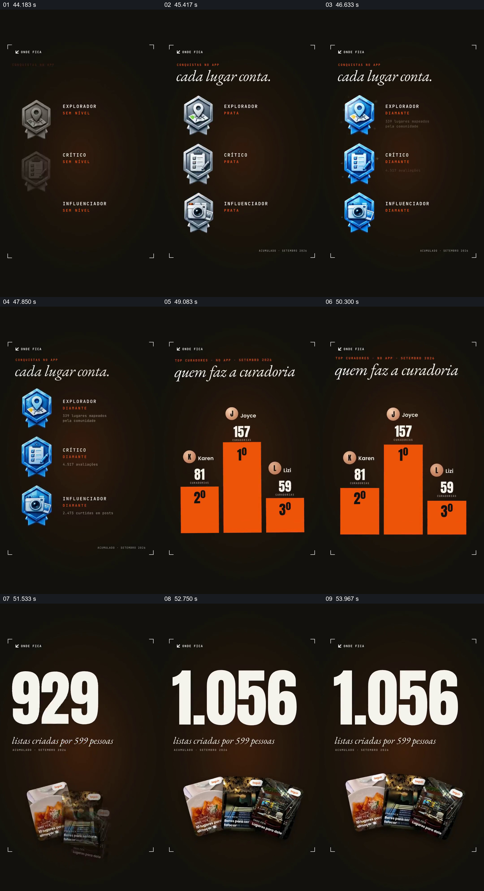

# 从贡献身份、个人排行到大家创建的清单

- 作品：案例 026《餐饮数据、微型场景与手机展示》（库内索引名称）。
- 原片范围：00:44.000–00:55.000，含起点、不含终点；[完整原片](../video.mp4)｜[本卡片段](c04.mp4)。
- 范围依据：从贡献徽章建立到排行和清单结果显露，之后进入品牌结尾。
- 观察方式与未确认范围：查看整片 64 帧总览和本卡分镜。未独立完成连续原速观看与听审；抽帧之间的运动、停顿与声音配合待复核。画面中的界面、数字与说明是作品呈现，未经额外核实；设计价值为基于画面的分析。

## 原画面具体怎样设计

深色背景下，三枚纵向排列的徽章分别对应探索、评论和分享类身份；每枚左侧是图形，右侧是身份名称与等级，抽帧中徽章由灰色逐步变为蓝色，并出现各自的数量说明。

随后徽章退出，画面中心出现橙色三档领奖台，三位用户头像、名字和数字分别位于柱体上方；中央较高的柱体标为第一。最后排行让位于大号 1,056，下方写由 599 人创建的清单，底部几张地点主题卡片扇形排列，显示集体产物的具体样子。

## 为什么这样设计，好在哪里

徽章先解释贡献类型，排行榜再把其中的人与数量对应，最后的清单总数和实物卡片将注意力从个人成绩转到大家产生了什么。三个阶段的阅读对象不同，但都围绕参与和成果；若只展示领奖台，难以看见贡献最终形成的内容。

等级、人数、排行和清单数字均是片中展示，未经本次核实。

## 可直接使用的创意指令

展示群体贡献时，先清楚区分各类角色或行为，再用有来源的个人或群体数据说明贡献；最后给出这些行为共同形成的实际产物，使统计与内容对应。图标、排名形式和人数可重设，不必使用竞赛式领奖台。

保留角色、数据口径与具体成果之间的联系；如不能公开个人信息，可用获授权的匿名形式。

本方法尚未在新题材中实测。
