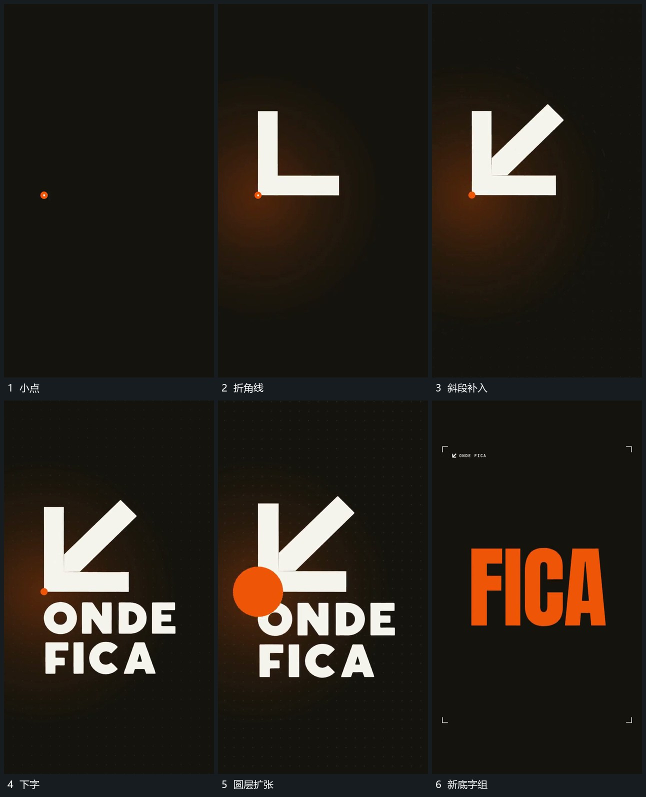

# 小点延成折角线，斜段加入后圆层扩张换底

## 运动指令

从小点延长折角线，再补入斜段，组成完整形。下方字组建立后，圆形层从共享端点附近扩大，遮住旧组并换入下一底层。

## 视频切片

[播放本机制的原片切片](m01.mp4)

覆盖分镜中“小点”至“新底字组”的连续过程，并保留邻近的前后衔接画面；原片中交叠发生的动作一并保留。

## 分镜过程

## 组合与调整

保留共享端点，圆层应覆盖交接，不能仅在角上闪一下。
