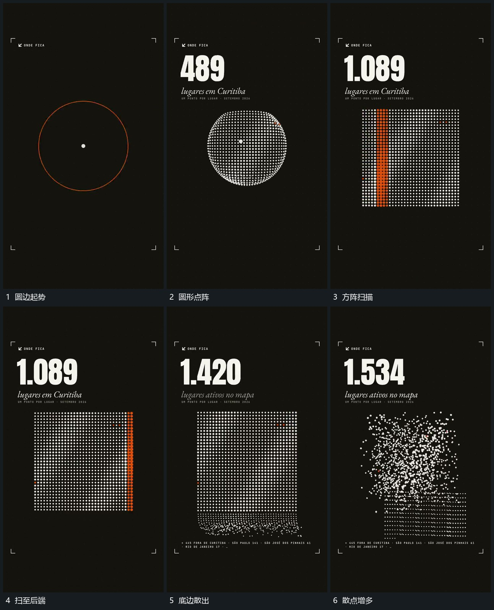

# 圆形点阵重排为方阵，扫描带经过后底部散出

## 运动指令

将圆形点阵整理成规则方阵，竖向扫描带横向经过，扫描完成的格位保留。随后从底边释放部分点向外散开，未释放的点仍按阵列留住。

## 视频切片

[播放本机制的原片切片](m02.mp4)

覆盖分镜中“圆边起势”至“散点增多”的连续过程，并保留邻近的前后衔接画面；原片中交叠发生的动作一并保留。

## 分镜过程

## 组合与调整

新片可分别采用重排或释放，需明确哪些点继续作为同一集合。
