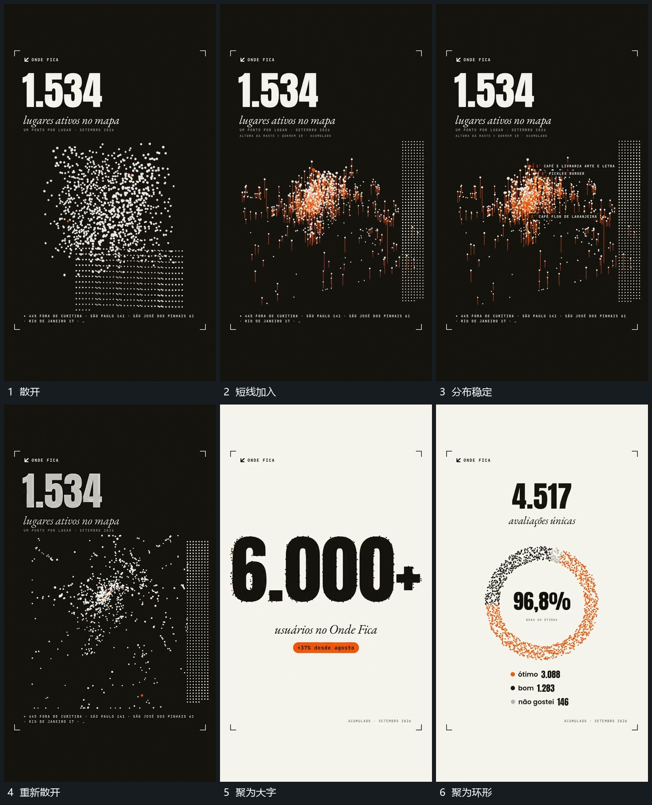

# 点群散开，带竖线重排后聚合成大字或圆环

## 运动指令

保留点群，从散乱位置重排成不同高度的分布，局部带竖向短线。之后再次散开并集中到目标区域，形成大字或环形，成形后内部短字接入。

## 视频切片

[播放本机制的原片切片](m03.mp4)

覆盖分镜中“散开”至“聚为环形”的连续过程，并保留邻近的前后衔接画面；原片中交叠发生的动作一并保留。

## 分镜过程

## 组合与调整

分镜包含后续两种目标，组合时选一个；形与数字的语义需重做，非真实计数证据。
