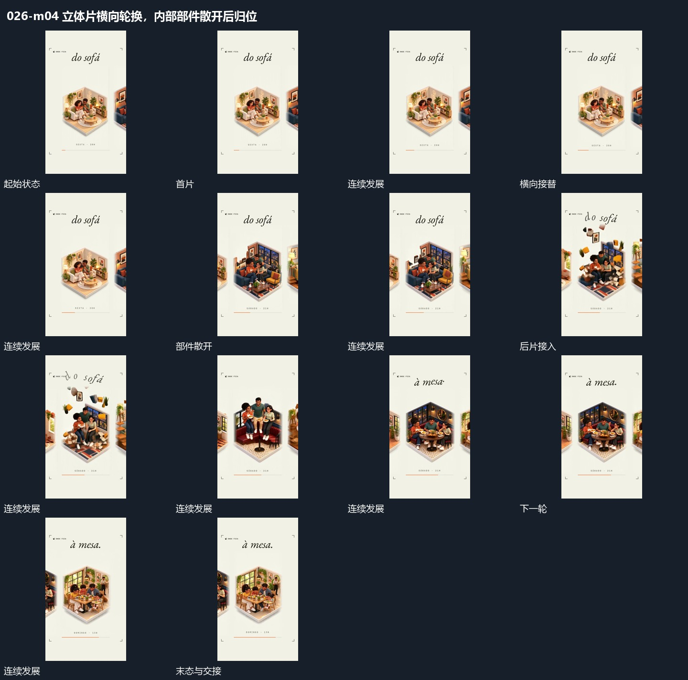

# 立体片横向轮换，内部部件散开后归位

## 运动指令

让并置立体片横向轮换，当前项停到中部。某轮中内部部件向上和周边短暂散开，随后回到片内，再让下一片接替，侧片仍露出边缘。

## 视频切片

[播放本机制的原片切片](m04.mp4)

覆盖分镜中“首片”至“当前片稳定”的连续过程，并保留邻近的前后衔接画面；原片中交叠发生的动作一并保留。

## 分镜过程

## 组合与调整

单片内部散开可以独立使用，必须保留归位来源，不把全部背景一起散开。
