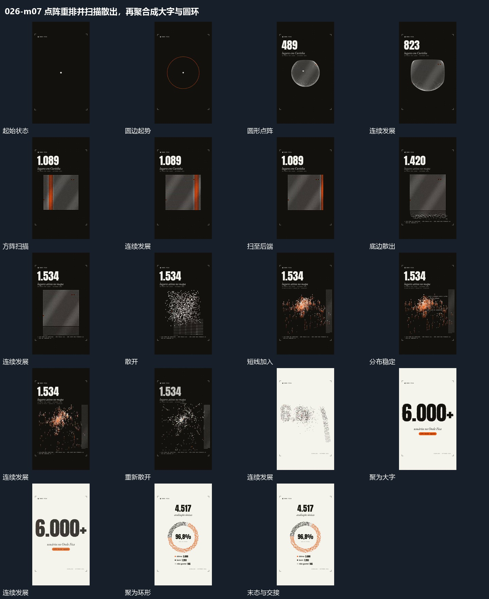

# 点阵重排并扫描散出，再聚合成大字与圆环

## 运动指令

圆点集合改排方阵，扫描带经过后底部散开；散点延续移动并逐渐重排、聚合成新形态。

1. **圆形点阵重排为方阵，扫描带经过后底部散出**

将圆形点阵整理成规则方阵，竖向扫描带横向经过，扫描完成的格位保留。随后从底边释放部分点向外散开，未释放的点仍按阵列留住。

2. **点群散开，带竖线重排后聚合成大字或圆环**

保留点群，从散乱位置重排成不同高度的分布，局部带竖向短线。之后再次散开并集中到目标区域，形成大字或环形，成形后内部短字接入。

整段结束：点重新聚合成稳定结构 保留必要落稳与交接，中间已建立的参照沿用到下一步骤。

## 视频切片

[播放本机制的原片切片](m07.mp4)

保留起始准备、连续发展和完成或明确交接；首尾按本段运动范围裁切，不拼接、不变速。相连的小动作合为同一完整段落。

## 分镜过程

## 组合与调整

圆点集合改排方阵，扫描带经过后底部散开；散点延续移动并逐渐重排、聚合成新形态。 复用时可调整元素数量、幅度和相对节奏，保留上述进入、交叠与完成关系；不直接沿用原片题材或时长。

新片可分别采用重排或释放，需明确哪些点继续作为同一集合。

分镜包含后续两种目标，组合时选一个；形与数字的语义需重做，非真实计数证据。
