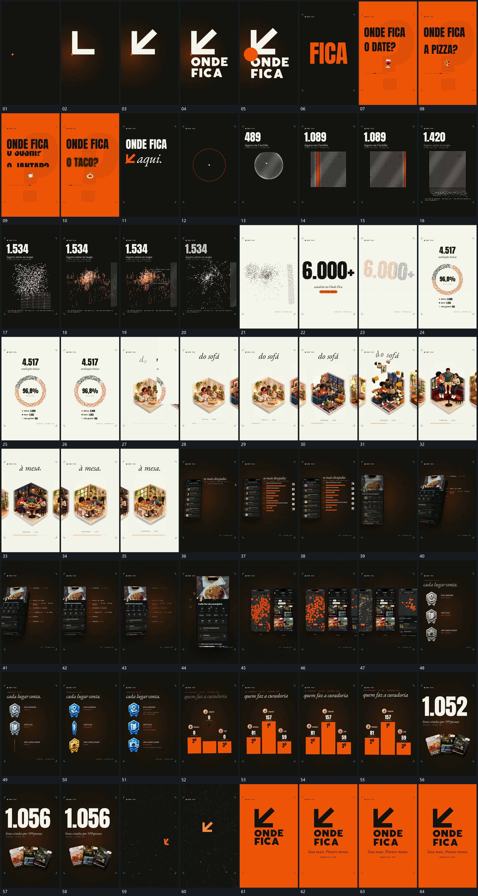

# 026｜原片运动总览

[观看完整原片](video.mp4)

## 运动总览

片头 小点延成折角线，斜段加入后圆层扩张换底 从小点建立折角线与斜段，字组接上，再用圆层扩张换底。短句轮换后 圆形点阵重排为方阵，扫描带经过后底部散出 将点阵从圆形改为规则方阵，竖向扫描带经过，底边点向外散开。

中段 点群散开，带竖线重排后聚合成大字或圆环 保留点群，散开后重排成带竖向短线的分布，再聚合成大字或环形。随后 立体片横向轮换，内部部件散开后归位 在并置立体片中横向轮换当前项，内部若干部件分散后重新归位。

后段进入竖框，竖框倾转靠近，侧边标注接力建立后缩排 让同一框倾转推近，旁侧标注逐项接入，之后缩排成多框集合。最后 柱形高度增长，数值随过程累加停稳 在并列柱形中同时增长高度与数值，结果留场后再接大数字、倾斜片组和中心标记。

## 完整运动段落

以下按原片中的出现顺序引用。建立、内部发展及完成反馈放在同一段中；同时发生的局部动作与运镜写在同一份指令里。不同段之间可以是连续接管，也可以是直接切换，不能仅凭条目相邻认定可直接拼接。重复出现的同类运动采用一次连续代表范围，切片不以逐段无缝覆盖整片为目标。

1. [小点延成折角线，斜段加入后圆层扩张换底](mechanisms/m01.md)：线段共享端点，圆层从该处扩张

2. [点阵重排并扫描散出，再聚合成大字与圆环](mechanisms/m07.md)：圆点集合改排方阵，扫描带经过后底部散开；散点延续移动并逐渐重排、聚合成新形态。

3. [立体片横向轮换，内部部件散开后归位](mechanisms/m04.md)：整片沿横向接替，部件只在当前片内散出

4. [竖框倾转靠近，侧边标注接力建立后缩排](mechanisms/m05.md)：同一框转动与尺度变化，标注保持局部对应

5. [柱形高度增长，数值随过程累加停稳](mechanisms/m06.md)：共同底边固定，柱与数字对应增长

切片保留起始准备、必要内部停顿和完成或明确交接；首尾省略无新发展的等待，持续运动不要求人为停住。以上基于真实源帧序列和重点边界核对，不等同于全片连续声画审片。

## 完整64宫格

