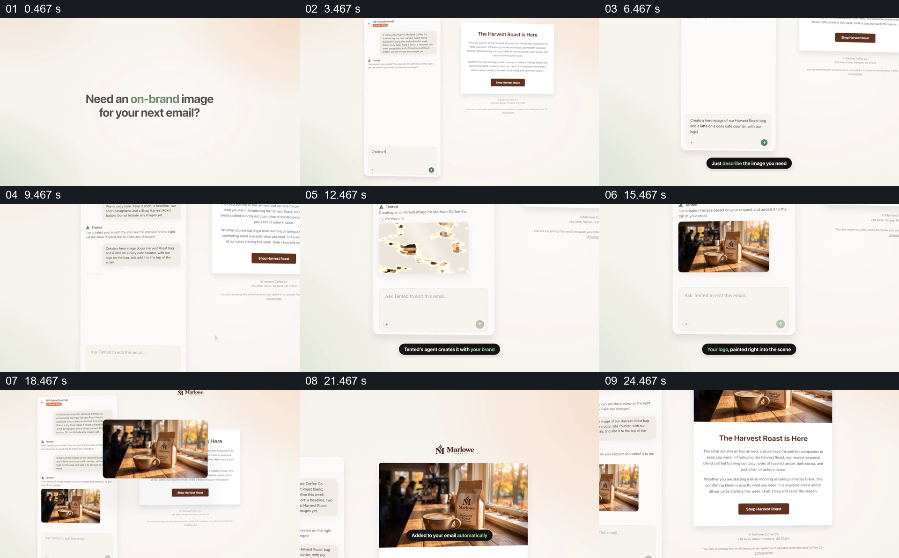

# 在邮件旁提出画面需求，再将结果放回邮件

- 作品：案例 025《为邮件生成并放入品牌图片》（索引名称）。
- 原片范围：00:00.000–00:27.000，含起点、不含终点；[完整原片](../video.mp4)｜[本卡片段](c01.mp4)。
- 观察方式：依据整片 64 宫格和约每秒一次的真实源帧观察，未连续原速观看或听审；声音、语气与完整播放节奏未确认。

## 原画面具体怎样设计

浅色画面提问“Need an on-brand image for your next email?”，随后左侧是对话输入区，右侧是一封咖啡主题邮件。输入描述后，左侧出现咖啡杯与包装袋位于窗边的图片，片中提示标识被放进画面；随后相同图片出现在邮件顶部，标题与正文保留在下方。

## 为什么这样设计，好在哪里

邮件从输入到结果一直作为参照，能看见配图为哪段内容服务；同一张图片从对话区域移动到邮件，明确展示了结果的去向。画面不能证明真实生成系统的品牌一致性或自动插入能力。

以上为依据画面的分析，非作者自述；预期观看效果未经观众测试。

## 可直接使用的创意指令

当一份已有邮件或页面需要配图时，先展示真实内容与配图位置，在旁边描述主体、场景及品牌约束；取得候选后核对标识、商品和文字，再把被采用的同一图片放回原位置，保留上下文检查。示意操作须标明，实际生成和发布以真实工具状态为准。
