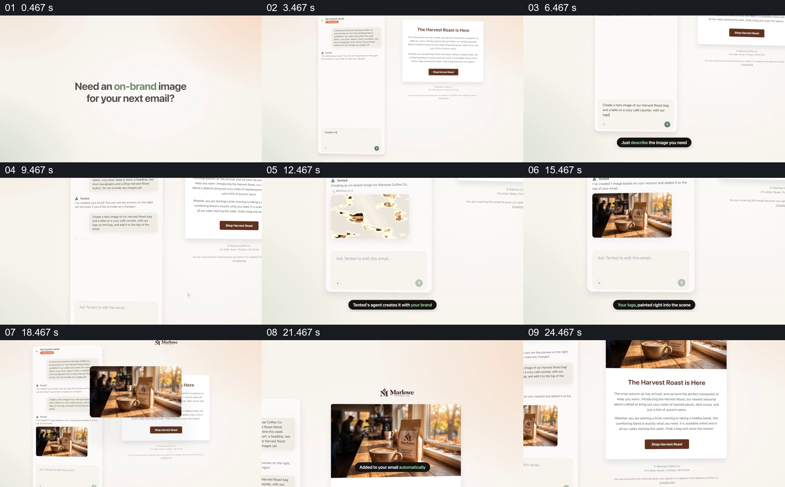

# 从文字要求生成一张图，再让它进入旁边的邮件

- 作品：案例 025《邮件配图的生成与放入》（库内索引名称）。
- 原片范围：00:00.000–00:27.000，含起点、不含终点；[完整原片](../video.mp4)｜[本卡片段](c01.mp4)。
- 范围依据：从需要配图的提问开始，到邮件中可见最终图文排版，品牌片尾另行结束。
- 观察方式与未确认范围：查看整片 64 帧总览和本卡分镜。未独立完成连续原速观看与听审；抽帧之间的运动、停顿与声音配合待复核。画面中的界面、数字与说明是作品呈现，未经额外核实；设计价值为基于画面的分析。

## 原画面具体怎样设计

浅色背景中央先提出“Need an on-brand image for your next email?”；接着左侧出现细长的对话界面，右侧是已有标题、正文和按钮的咖啡邮件预览。邮件先以无大图的状态建立，给后面变化留下可比较的基准。

左侧输入框逐步出现要求：咖啡袋与拿铁位于温暖咖啡店台面，并带有品牌标识。提交后聊天中出现图片占位，再逐渐显现咖啡杯、窗边木桌与品牌咖啡袋；右侧原邮件仍在画面里，底部黑色小字条提示当前步骤。

之后这张咖啡图从左侧结果区域扩大到画面中央，再出现在右侧邮件标题上方。邮件放大后，图片、标题、正文和按钮组成新的完整页面；最后画面回到聊天与邮件并列，确认新增素材处于原邮件之中。

## 为什么这样设计，好在哪里

聊天与邮件并置，使输入和被修改的对象同时有参照；生成图先在左侧独立形成，随后转入右侧邮件，观众能看见素材从哪里来、最终落在哪里。若只给完成后的邮件，就无法理解图像与请求的关系；若只显示生成图，也无法说明它如何影响原有排版。

画中图片生成和自动放置是产品演示，未据此验证实际功能或品牌授权。

## 完整照排指令

以[完整原片](../video.mp4)的 0–27 秒为准。画幅 1280×720，源帧率 30/1。以下拍点为抽帧定位，位置按画幅百分比取近似值。

### 用料

【生成请求】【生成图】【邮件初版】【邮件成稿】须属于同一案例。成稿把同一【生成图】嵌到头图位，准备可辨场景特征和一致宽高比。备【引题】【过程字幕组】【会话内容】【邮件标题】【邮件正文】【邮件按钮】【品牌标识】【品牌副句】【入口按钮】。若展示真实操作，保留请求记录、图片出处、邮件版本，授权素材避免露私人地址。

### 按源时刻摆放

1. **0–约 2 秒。** 米白底带淡黄绿晕，中央偏上用紧凑深色无衬线排两行【引题】，重点词可转 低饱和绿，随后全退。
2. **约 2–9 秒。** 左边白底窄高会话窗，右上白色【邮件初版】，窄窗包含细顶栏和低位输入区。待窗体稳定，在左窗底部逐字打【生成请求】，下缘小发出符号接操作。顶部逐组补【会话内容】灰泡。右邮件标题、正文及棕色小【邮件按钮】保持，头图位预留。底部小黑胶囊用白字【过程字幕组】，随阶段更换。
3. **约 9–16 秒。** 左会话内出现浅色横图片框，短暂无内容，再逐步从碎片到清晰【生成图】。窗从输入到完成保持相同宽度，不跳到另外一个会话。咖啡或新题材主体占视觉中心，右邮件仍同在。图可用一个静帧分层揭露，不循环生成；成形后留完整结果读图。
4. **约 16–23 秒。** 同一【生成图】的副本从左窗结果位脱离并移向右侧头图，原图在左窗短留作为对应参照。邮件靠近画心放大成【邮件成稿】，图在上，【邮件标题】【邮件正文】依次排在下，按钮维持同色。 移入图保持景物与原图相同，允许适当横裁，不换一张近似照。两窗同时留至邮件重点成立。
5. **约 23–27 秒。** 会话及邮件退淡，暖白底上居中建立绿符号与深字【品牌标识】，下面小【品牌副句】，再落绿胶囊【入口按钮】，按 27.000 秒切出。

### 局部采用

只有实际请求和对应输出可取约 2–16 秒；只有已授权图片和同源邮件两版可取约 16–23 秒，交代图片出处。

### 验证状态

已对照逐秒原片画序并读回，核对左右窗同步保留、左图形成、同图移动至右窗头部和品牌切出。输入原文、精确切帧和换料待核。
