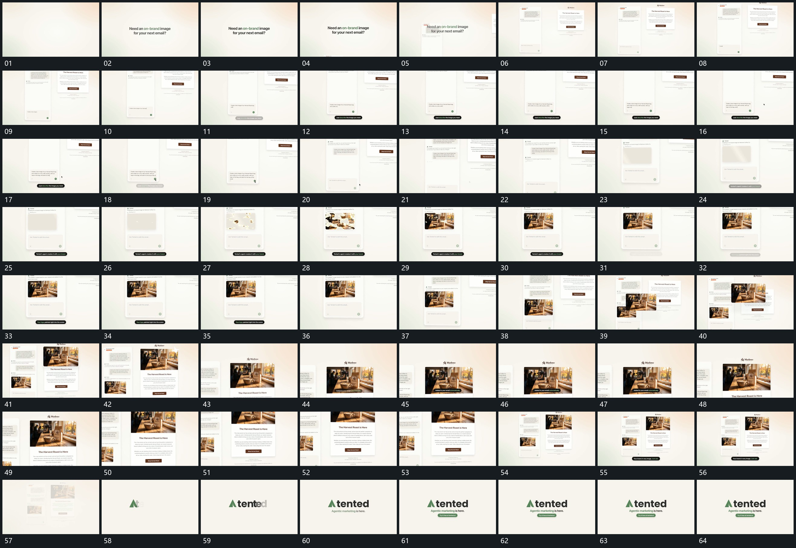

# 025｜原片运动总览

[观看完整原片](video.mp4)

## 运动总览

开头两行字组建立，并置长框接入，内部文字逐字增加 从不同空位接入并置长框，原字退出后框内输入逐字增加。中段 图像从零散块面逐步显出，补齐固定范围 在固定图像区域先用零散块面显出，再补齐整幅，外框与旁侧内容保持。

接着 内部图像提为前景片，跨到旁框后归入内部 从内部提起图像作为独立前景片，移到旁框上方，来源处仍保留内容；前片收回后图像出现在旁框内部。之后 并置框共同靠近，旁片接续后缩回整体 使并置框共同推近与横移，侧卡接续补入，再缩回完整布局。末尾整组减淡，标记与短行逐项建立。

## 完整运动段落

以下按原片中的出现顺序引用。建立、内部发展及完成反馈放在同一段中；同时发生的局部动作与运镜写在同一份指令里。不同段之间可以是连续接管，也可以是直接切换，不能仅凭条目相邻认定可直接拼接。重复出现的同类运动采用一次连续代表范围，切片不以逐段无缝覆盖整片为目标。

1. [并置长框接入，内部文字逐字增加](mechanisms/m01.md)：框先落位，字符在固定内部累积

2. [图像从零散块面逐步显出，补齐固定范围](mechanisms/m02.md)：零散可见片逐渐增多，边界不动

3. [局部图提起跨框归位，推近检查后返回并置整体](mechanisms/m05.md)：局部由源框提出并跨入旁框，落位后两框共同靠近，旁片补入；最后缩回整体完成交接。

切片保留起始准备、必要内部停顿和完成或明确交接；首尾省略无新发展的等待，持续运动不要求人为停住。以上基于真实源帧序列和重点边界核对，不等同于全片连续声画审片。

## 完整64宫格

