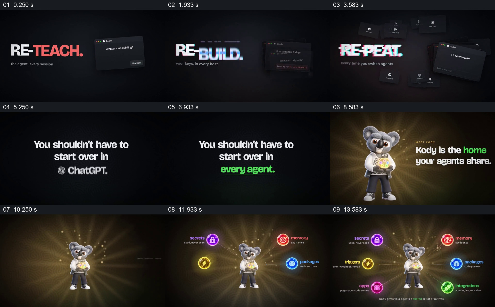

# 把不同环境中的重复工作汇到一个共享中心

- 作品：案例 069（库内案例）。
- 原片范围：0.000–15.000 秒；[原片](../video.mp4)｜[片段](c01.mp4)。含起点、不含终点。
- 观察方式：查看全片 64 格及本卡九宫格；未独立原速连续观看、听审，功能宣称和迁移未核实。

## 原画面具体怎样设计

深色背景左边依次显示 RE-TEACH、RE-WIRE、RE-BUILD、RE-PEAT 等大字，右侧是多层工具对话窗口；字词中的重复前缀成为视觉共同点。接下来文字改为“You shouldn’t have to start over in…”，工具名在同一位置变换，最后换成绿色的“every agent”。

金色放射背景中，抱着发光小物件的考拉置于左侧，右侧文字说它是多个智能体共享的家；角色缩到中央后，记忆、密钥、触发器、应用、集成和代码包等不同颜色的圆形图标在四周展开，细线连接中心，每个图标旁有简短用途说明。

## 为什么这样设计，好在哪里

先用一致的 RE- 结构把分散的麻烦归为一类，再让同一句话容纳不同工具名，说明问题不只存在于一个环境。角色从介绍对象变成关系图中心，外围图标将抽象的“共享家”拆成可辨认的功能；图中说明是产品宣称，未证明功能或安全效果。

## 完整照排指令

以[完整原片](../video.mp4)的 0–15 秒为准。画幅 1280×720，源帧率 60/1。以下拍点为抽帧定位，位置按画幅百分比取近似值。

### 源时刻照排

- 0–约 4 秒，深黑绿底左侧粗体【重复动作词】逐拍换词，共用白色前缀，其余字换红、紫、蓝等强调色；下方灰色小【动作解释】。右侧偏斜层叠【工具窗口】，跟左侧依次换内容，最后一词短促错色扰动。
- 约 4–8 秒，窗退，居中排两行白粗体【转折句】，下缘同位置快换【工具名称】，以绿色【共同对象】停住后收进中心暖光。
- 约 8–10 秒，金色放射背景中，左侧【中心角色】抱发光物，右侧黑白对比区域放两行白粗体【产品归属句】，点绿核心词。角色随后缩至画心，保留同一发光物与轮廓。
- 约 10–15 秒，圆形【功能图标】按颜色从角色周围展开，左、右各三组，用细线指向中心，【功能名称】在各图标外沿以同色排印，下置较小白字【功能释义】。末端留全图读时，15 秒切出本卡。

### 用料与取用

【重复动作词】【动作解释】需有一组可同前缀排印、内容能相互区别的短词。【工具窗口】【工具名称】分别对应同一组应用及具体使用场景，0–约 4 秒各显示一次，有真实操作才用相应录屏，静态窗口可作合成图层。【转折句】【共同对象】【产品归属句】保持同一主张。【中心角色】约 8–15 秒持续，从左缩到中，交可缩放主体和手持物、光效分层；可用透明静态角色配位置缩放，若交表演则用持续镜头，不重复起跳或用定格替代动作。【功能图标】【功能名称】【功能释义】同源于该产品的一套实际能力，交产品版本及可核对功能页面。仅有开场词与窗口可用 0–约 8 秒，删去没有支撑的品牌承诺；有角色和能力组可单取约 8–15 秒。

### 验证状态

已对照原片逐秒抽帧与卡稿，核查共同前缀、换名位置、角色集中与左右图标建立。精确切点、原速听看与换料试摆待核。
