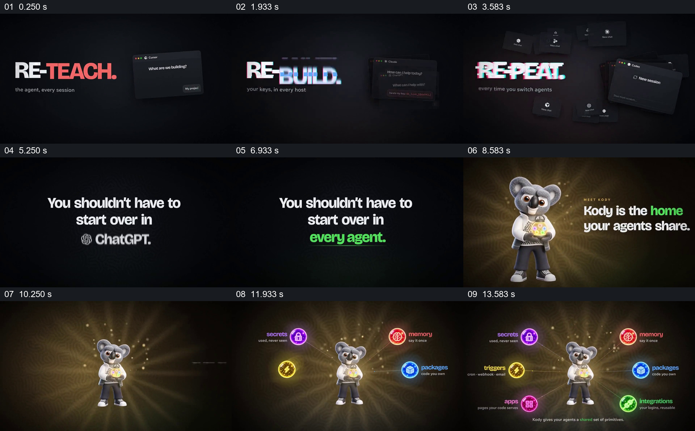

# 把重复配置的困扰接到共享中心及其功能

- 作品：案例 069《智能体共享工作空间》（本次概括）。
- 原片范围：00:00.000–00:15.000，含起点、不含终点；[完整原片](../video.mp4)｜[本卡片段](c01.mp4)。
- 观察方式：依据约每秒一次的真实源帧观察，未连续原速观看或听审；声音、语气与完整播放节奏未确认。

## 原画面具体怎样设计

黑底上依次出现 RE-WIRE、RE-BUILD、RE-PEAT，旁边配不同工具的深色窗口；接着同一句“不必重新开始”下面轮换工具名称，最后概括为每个智能体。画面换成抱着发光物件的考拉角色，文字称它是各智能体共享的家；角色缩小居中后，记忆、密钥、触发器等彩色图标逐项围绕它展开。

## 为什么这样设计，好在哪里

三个重复动作与不断替换的工具名先把问题聚在同一件事上，角色和环绕图标再将抽象的共享空间变成有中心的结构。图标表达产品声称具备的功能，不能据画面确认其实际效果。

以上为依据画面的分析，非作者自述；预期观看效果未经观众测试。

## 可直接使用的创意指令

介绍需要跨工具复用的服务时，先用同一类重复任务和不同工作环境建立问题，再给共享对象一个稳定的中心形象，让实际可用的功能围绕中心出现并标清各自作用；保留问题与对应功能的关系，名称、角色和视觉形式按产品调整。
