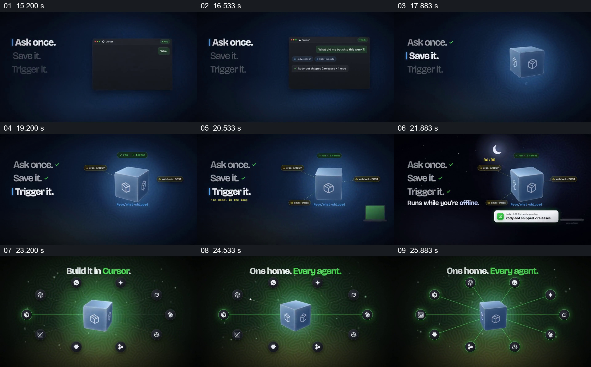

# 让一次请求成为可触发对象，再连接多个工具

- 作品：案例 069（库内案例）。
- 原片范围：15.000–27.000 秒；[原片](../video.mp4)｜[片段](c02.mp4)。含起点、不含终点。
- 观察方式：查看全片 64 格及本卡九宫格；未独立原速连续观看、听审，功能宣称和迁移未核实。

## 原画面具体怎样设计

蓝黑背景左侧纵排 Ask once、Save it、Trigger it，右侧是对话窗口；当前步骤较亮，完成的步骤旁出现绿色勾号。一次提问和答复后，窗口换成蓝色立方体，周围出现定时、Webhook、邮件等标签，旁边又出现月亮、关闭的电脑和通知卡，说明片中宣称的离线运行结果。

背景转绿，立方体保留在中央，周围工具图标排成圆环并以线连向它；顶部文字由在某工具中建立、在另一工具中运行，转为“One home. Every agent.”。同一视觉对象从任务载体变成多个环境共享的中心。

## 为什么这样设计，好在哪里

左边固定步骤给观众方向，右边从实际请求、可保存对象到通知结果逐步换状态，抽象的复用流程才有一个可以跟随的对象；保留立方体进入多工具关系图，避免后半突然变成另一个无关概念。动画界面和通知是演示，不能证明后台作业真实运行。

## 完整照排指令

以[完整原片](../video.mp4)的 15–27 秒为准。画幅 1280×720，源帧率 60/1。以下拍点为抽帧定位，位置按画幅百分比取近似值。

### 源时刻照排

- 15–18 秒，蓝黑渐晕底。左侧三行无衬线【操作步骤】按提问、保存、触发垂直排列，当前一行白亮，其余低对比，完成后尾部加绿勾。右侧深底【对话窗口】先显示【提问原句】再补【回答原句】。
- 18–23 秒，右窗收成发蓝光的【任务立方体】，左栏原位推进。依次在立方体四周放【触发入口】，其后补月亮、关机电脑及【运行通知】，左栏下方给小字【离线说明】。
- 23–27 秒，绿色光圈扩开并居中立方体，【工具图标】环绕球心并用细线相连。上方两段【环境切换句】原位换词，最后换【共享结论】，工具词用亮绿。27 秒切至角色品牌画面。

### 用料与取用

【操作步骤】【提问原句】【回答原句】【对话窗口】【任务立方体】指向同一保存任务；后续【触发入口】【运行通知】【离线说明】需交实际触发类型、通知内容、运行条件及可核对的功能出处和版本。【工具图标】【环境切换句】【共享结论】按同一任务实际支持的环境填写。右窗约 15–18 秒展示一次输入和结果，若为静态图层须把两态分开；立方体自约 18 秒持续至 27 秒，位移和缩放可用分层静态图形，环绕及触发按动作建立，禁止循环发出通知。只有对话及保存结果，单取 15–18 秒；只有触发及结果，取 18–23 秒并在入点给已保存状态；只有环境支持证明可取 23–27 秒。

### 验证状态

已对照原片抽帧与卡稿，核查左列逐步完成、窗口变成立方体及立方体在绿环中延续。原速听看、准确切点与换料试摆待核。
