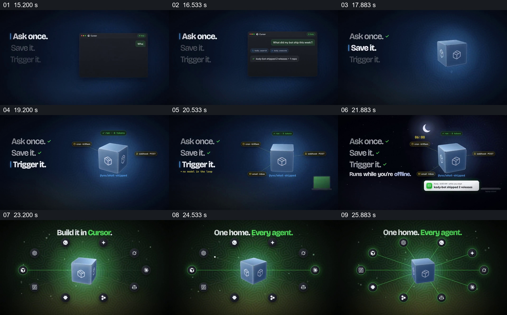

# 把一次请求保存并触发，再显示不同工具接入同一对象

- 作品：案例 069《智能体共享工作空间》（本次概括）。
- 原片范围：00:15.000–00:27.000，含起点、不含终点；[完整原片](../video.mp4)｜[本卡片段](c02.mp4)。
- 观察方式：依据约每秒一次的真实源帧观察，未连续原速观看或听审；声音、语气与完整播放节奏未确认。

## 原画面具体怎样设计

左侧依次强调 Ask once、Save it、Trigger it，右侧先出现对话窗口，再换成承载任务的立方体；方块周围出现标签，月亮图标和通知提示任务离线运行。随后背景转绿，立方体置中，与周围工具标记连线，顶部文字先后指向不同工具，最后显示一个中心连接多个智能体。

## 为什么这样设计，好在哪里

文字步骤和右侧对象同步变化，让观众把抽象的复用过程对应到一个持续存在的对象；同一个方块再接多个工具，延续了前面保存的概念。窗口和通知属于作品示意，不能视为真实运行记录。

以上为依据画面的分析，非作者自述；预期观看效果未经观众测试。

## 可直接使用的创意指令

介绍可复用的工作任务时，用真实示例明确请求、保存内容、触发方式和结果反馈；让同一个可辨对象贯穿这些步骤，再将它接到实际支持的环境，说明共享的是哪部分状态和哪些操作。视觉对象可替换，但过程与产品实际能力必须对应。
