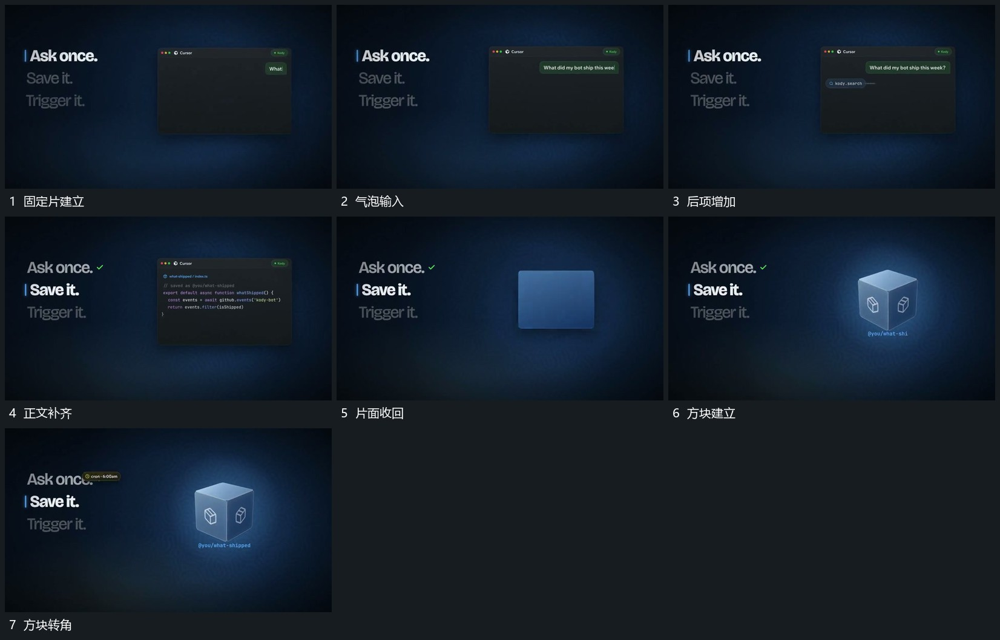

# 固定片内内容逐行增加，片面收成方块后转角

## 运动指令

在固定片内逐行增加气泡与正文，前项留住。内容完成后片面收回为较紧凑方形，再转角显出几面轮廓，成为后续持续主形，外部列表保持。

## 视频切片

[播放本机制的原片切片](m04.mp4)

覆盖分镜中“固定片建立”至“方块转角”的连续过程，并保留邻近的前后衔接画面；原片中交叠发生的动作一并保留。

## 分镜过程

## 组合与调整

不推定真实生成代码，方块可以由新片平面材料接续构成。
