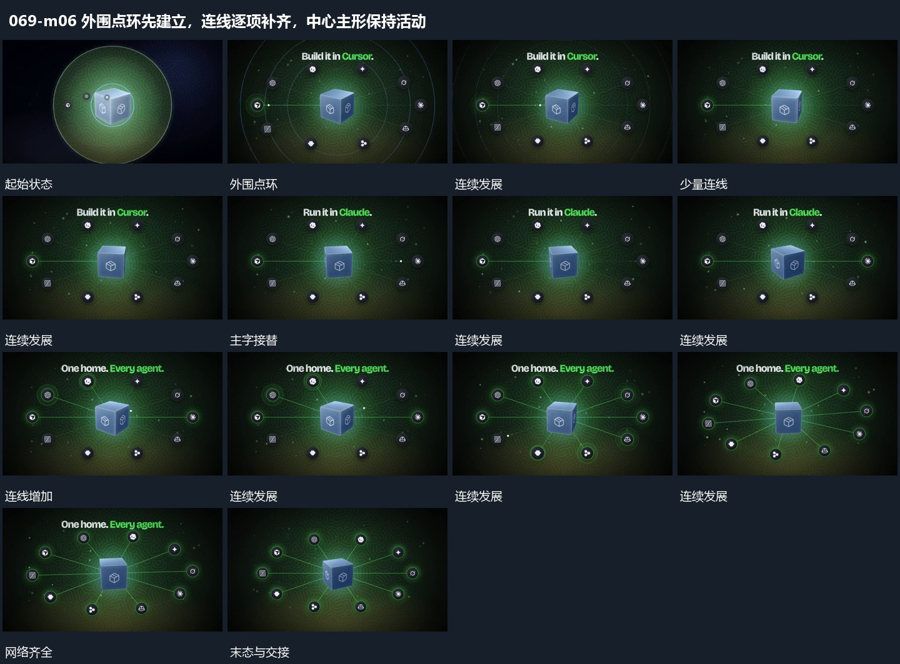

# 外围点环先建立，连线逐项补齐，中心主形保持活动

## 运动指令

围中央方块建立一圈分散点，点环位置落稳后逐项补齐到中心的连接。中央方块继续小幅转动，外围点保持，整组完整后缩回，为结尾主形让位。

## 视频切片

[播放本机制的原片切片](m06.mp4)

覆盖分镜中“外围点环”至“整组缩回”的连续过程，并保留邻近的前后衔接画面；原片中交叠发生的动作一并保留。

## 分镜过程

## 组合与调整

与单点入场机制可组合，先排点再连线能减少全组同时活动。
