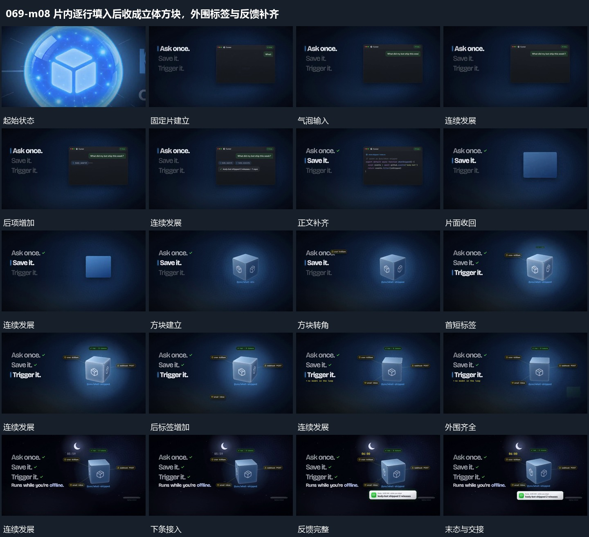

# 片内逐行填入后收成立体方块，外围标签与反馈补齐

## 运动指令

固定片内逐行增加内容，整个片面收为方块并转角；方块持续转动，外围短标签分项接入，最后反馈条出现。

1. **固定片内内容逐行增加，片面收成方块后转角**

在固定片内逐行增加气泡与正文，前项留住。内容完成后片面收回为较紧凑方形，再转角显出几面轮廓，成为后续持续主形，外部列表保持。

2. **方块持续转动，外围短标签分项加入，反馈条后接**

让中央方块持续小幅转动，周边短标签分项加入。标签确立后以细线关联中心，下方短条最后接入并补反馈，主形与外围位置稳定。

整段结束：标签与细线齐全，反馈建立 保留必要落稳与交接，中间已建立的参照沿用到下一步骤。

## 视频切片

[播放本机制的原片切片](m08.mp4)

保留起始准备、连续发展和完成或明确交接；首尾按本段运动范围裁切，不拼接、不变速。相连的小动作合为同一完整段落。

## 分镜过程

## 组合与调整

固定片内逐行增加内容，整个片面收为方块并转角；方块持续转动，外围短标签分项接入，最后反馈条出现。 复用时可调整元素数量、幅度和相对节奏，保留上述进入、交叠与完成关系；不直接沿用原片题材或时长。

不推定真实生成代码，方块可以由新片平面材料接续构成。

标签端点要落在实际主形范围内，不让连线随着转角脱离来源。
