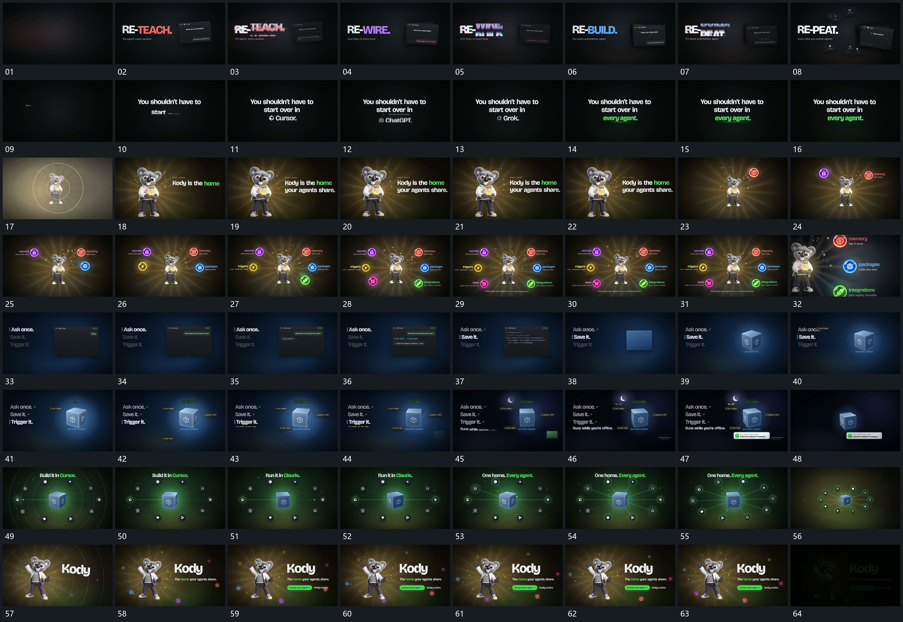

# 069｜原片运动总览

[观看完整原片](video.mp4)

## 运动总览

开头 主字短暂错位叠影后接替下一组，旁片同步更新 让主字短暂错位叠影，接替成下一字组，旁片同时更新。中央字组分行建立，环形后层展开，一侧主形保持，旁字逐行补齐 保留一侧主形，环形后层展开，旁字逐行补齐。主形缩回中央，外围圆点逐项加入并连接到中心 让主形缩小回中部，外围圆点逐项加入，连接线从中心延到各点。

中段 固定片内内容逐行增加，片面收成方块后转角 固定片中气泡和正文逐行增加，完成后片面收成方块，方块转角并建立几面轮廓。方块持续转动，外围短标签分项加入，反馈条后接 方块保持转动，周边短标签分项加入，以细线连接，下方反馈条最后出现。后段 外围点环先建立，连线逐项补齐，中心主形保持活动 外围点环先立，连接线逐项补齐，中心方块持续小幅转动。末段整组缩回，主形与字组接管，外围小点继续经过，附属行与底条补齐后退暗。

## 完整运动段落

以下按原片中的出现顺序引用。建立、内部发展及完成反馈放在同一段中；同时发生的局部动作与运镜写在同一份指令里。不同段之间可以是连续接管，也可以是直接切换，不能仅凭条目相邻认定可直接拼接。重复出现的同类运动采用一次连续代表范围，切片不以逐段无缝覆盖整片为目标。

1. [主字短暂错位叠影后接替下一组，旁片同步更新](mechanisms/m01.md)：叠影经过，原位替换

2. [环形后层展开，主形收向中央并补齐外围连接](mechanisms/m07.md)：主形与旁字先在环形后层前建立，随后主形缩回中央，外围圆点逐项加入并连向中心，完成关系网络。

3. [片内逐行填入后收成立体方块，外围标签与反馈补齐](mechanisms/m08.md)：固定片内逐行增加内容，整个片面收为方块并转角；方块持续转动，外围短标签分项接入，最后反馈条出现。

4. [外围点环先建立，连线逐项补齐，中心主形保持活动](mechanisms/m06.md)：外围先排好，连线后增加

切片保留起始准备、必要内部停顿和完成或明确交接；首尾省略无新发展的等待，持续运动不要求人为停住。以上基于真实源帧序列和重点边界核对，不等同于全片连续声画审片。

## 完整64宫格

