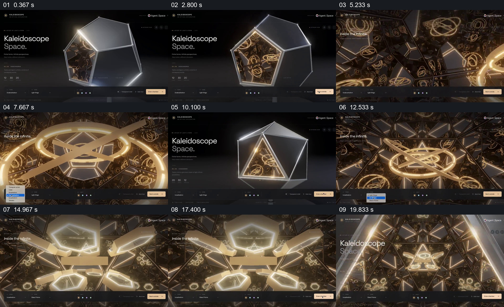

# 用外壳开口带观众进入对称的内部空间

- 作品：案例 104《万花筒网页的内外空间》（本次概括）。
- 原片范围：00:00.000–00:21.896，含起点、不含终点；[完整原片](../video.mp4)｜[本卡片段](../video.mp4)。
- 观察方式：依据约每秒一次的真实源帧观察，未连续原速观看或听审；声音、语气与完整播放节奏未确认。

## 原画面具体怎样设计

深色网页中一个多面体位于中央，页面标题和控制栏环绕；视点靠近其中发光开口，画面进入金色圆环、镜面与重复图形构成的内部。之后回到外部多面体，另一角度再次接近三角形入口，内部的环和对称图形变换，结尾回到多面体外观。

## 为什么这样设计，好在哪里

相同外壳与内部开口为复杂镜面画面提供入口和出口，重复图形则让内部空间形成独特的观看体验；界面持续保留使其仍被认作一个网页演示。

以上为依据画面的分析，非作者自述；预期观看效果未经观众测试。

## 可直接使用的创意指令

表现一个可进入的视觉对象时，先清楚展示外壳与入口，再沿入口进入内部并保留能够辨认的形状或材质联系；内部变化完成后回到外观。具体几何、镜面效果和交互方式按实际作品调整。
