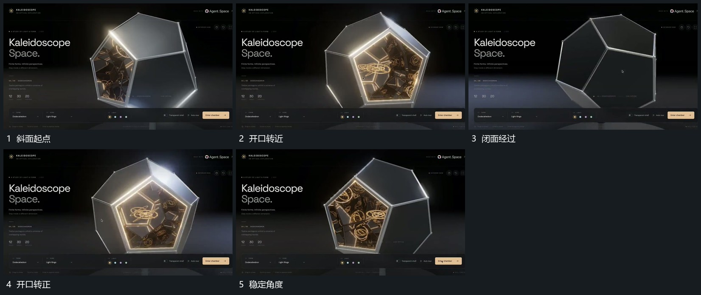

# 多面组围中心转向使选定开口朝前

## 运动指令

保持多面组中心，整体连续转角，让闭合面与开口先后经过前方。选择开口后逐步收小转角，使其朝向取景，内部小组仍在开口后方活动，旁侧前层可保持位置。

## 视频切片

[播放本机制的原片切片](m01.mp4)

覆盖分镜中“斜面起点”至“稳定角度”的连续过程，并保留邻近的前后衔接画面；原片中交叠发生的动作一并保留。

## 分镜过程

## 组合与调整

可用任意多面结构；开口是同一物体的一面，不在转角中更换来源。
