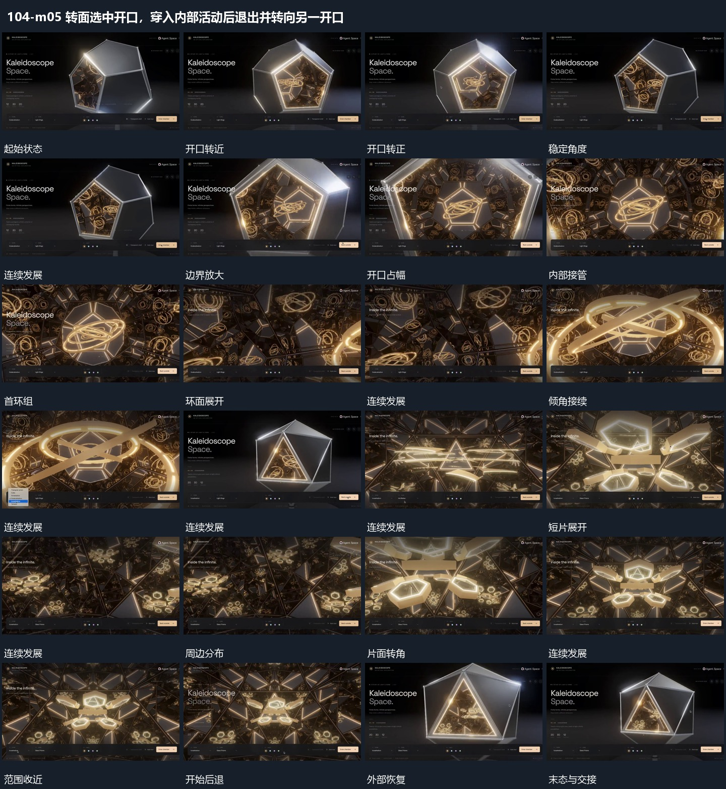

# 转面选中开口，穿入内部活动后退出并转向另一开口

## 运动指令

起始：多面组以斜面朝前。

1. 外部多面组先转向选定开口，观看范围沿开口推进。

2. 内部斜环围共同中心转动，退出后改变方向，另一内部的短片围中心展开并改变倾角，最后退回外部。

上述镜头变化与局部动作按同一条连续过程推进；写明同时发生的步骤在原场面中交叠，不先完成整段运镜再重演局部。

## 视频切片

[播放本机制的原片切片](m05.mp4)

保留起始准备、连续发展和完成或明确交接；首尾按本段运动范围裁切，不拼接、不变速。相连的小动作合为同一完整段落。

## 分镜过程

## 组合与调整

保留以下动作关系：外部多面组先转向选定开口，观看范围沿开口推进；内部斜环围共同中心转动，退出后改变方向，另一内部的短片围中心展开并改变倾角，最后退回外部。

可调整位移距离、层级间距、重复数量与相对快慢；已有锚点和未退出的层继续承接。连接下一段时以切片末态为起点，另行设计不连续的状态转换。
