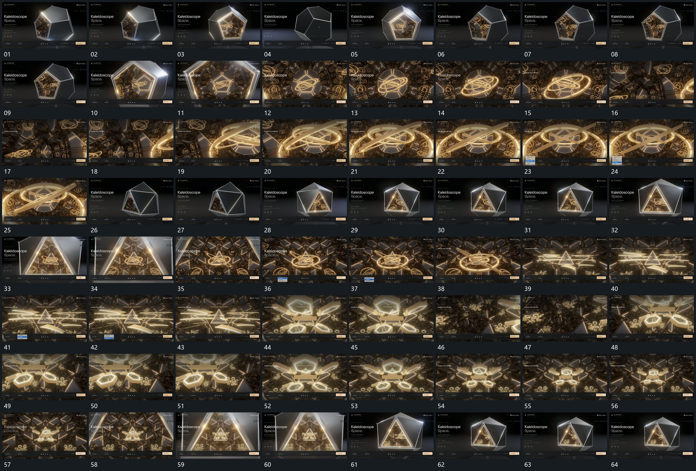

# 104｜原片运动总览

[观看完整原片](video.mp4)

## 运动总览

全片先用多面组围中心转向使选定开口朝前让多面组围中心转向，选定的开口朝向取景后，沿开口推入重复结构后反向退出外部沿开口推进，外围边界越界，内部重复结构接管。内部多个倾角环围共同中心持续转向让多个倾角环围共同中心持续转向，取景在近处小幅转角。

退回外部后再次复用多面组围中心转向使选定开口朝前与沿开口推入重复结构后反向退出外部进入另一边界形态；内部改用多个短片围中心展开并连续改变倾角，多个短片围中心展开并持续改变倾角。最后沿沿开口推入重复结构后反向退出外部反向退出，回到外部全貌，重复段不增加新卡。

## 完整运动段落

以下按原片中的出现顺序引用。建立、内部发展及完成反馈放在同一段中；同时发生的局部动作与运镜写在同一份指令里。不同段之间可以是连续接管，也可以是直接切换，不能仅凭条目相邻认定可直接拼接。重复出现的同类运动采用一次连续代表范围，切片不以逐段无缝覆盖整片为目标。

1. [转面选中开口，穿入内部活动后退出并转向另一开口](mechanisms/m05.md)：外部多面组先转向选定开口，观看范围沿开口推进；内部斜环围共同中心转动，退出后改变方向，另一内部的短片围中心展开并改变倾角，最后退回外部。

切片保留起始准备、必要内部停顿和完成或明确交接；首尾省略无新发展的等待，持续运动不要求人为停住。以上基于真实源帧序列和重点边界核对，不等同于全片连续声画审片。

## 完整64宫格

