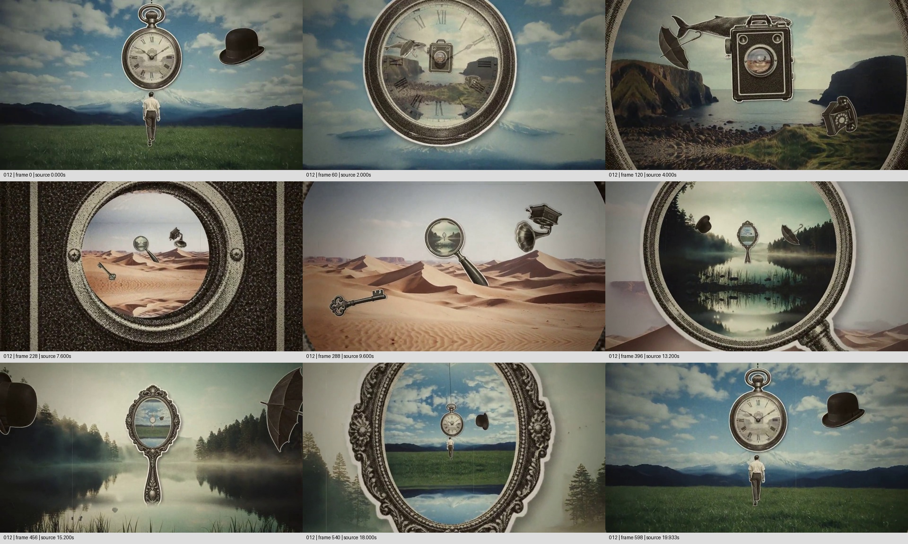
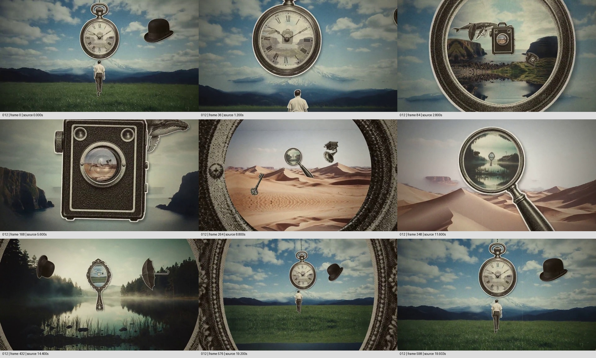

# 让旧物里的风景变成下一处世界，最后在镜中认回起点

来源：案例012《复古拼贴与镜头穿越》，索引作者 koldo2k。[来源页面](https://skillry.dev/ai-videos/opus-5-5/koldo2k-778767)。

范围：完整原片 **[0.000, 20.062)秒**。[观看完整创意片段／原片](../video.mp4)。本卡覆盖整片，视频与片段共用原文件。

观察方式：2026-11-05按定稿版重新抽取原片每0.4秒定位帧至19.6秒及末帧19.933秒；另查开头0—4秒每0.5秒与18—19.6秒每0.4秒、末帧，复查本轮正式分镜。**frame-only，未原速连续观看、未听审**。只能确认抽样状态与前后关系，不认证全程运动平滑度、镜头轨迹、首尾无缝或声音设计。所见景观、人物与旧物有摄影／版画式外观，来源与制作方式未知，不把拼贴场面写成真实旅行记录。

补图源帧：0、36、84、168、264、348、432、576、598；源时间依次为0.000、1.200、2.800、5.600、8.800、11.600、14.400、19.200、19.933秒。

## 1. 原画面具体怎样设计

**开场用熟悉物件建立一处不合常规的空间。** 画面为横幅草地与远山，阴云间有蓝天，背向观众的人站在下方，巨大的怀表悬在他的上方，黑色礼帽漂在一侧。人和地平线先提供尺度，放大的怀表打破这个尺度。约0—1.6秒，怀表在视野里逐渐变大，人趋向下边缘，礼帽的位置和朝向变化；观众的观察目标落到表面，而不是跟人物开始一条行动故事。

**表盘从物件表面变成可进入的景。** 约1.6—3.6秒，罗马数字和指针所在区域里显出海湾、两侧崖岸及中央老式相机，外围仍留着怀表金属边缘与原草地天空。表盘信息逐渐变弱，海湾取得内部面积。约4秒，海湾已成为主要环境；中央是正面朝向观众的相机，旁边散布鲸、伞、拨号电话等剪贴物。原先被表框包住的图像开始承担整个场景的背景，相机又提供下一处观察目标。

**相机不是被拿来拍照，而是用镜头承载下一层。** 约4—9.6秒，相机越来越大，镜头内提前可见沙丘和几件小物；外层海湾、相机机身与内层暖色沙漠一度同时存在。鲸、伞、电话等外围物的位置与姿态随过程改变，逐渐接近边缘或离开主要视野。相机的黑色皮革机身和金属镜圈在靠近时成为包围沙漠的大边界，镜圈向画边退开，沙漠取得主画面。不是先把相机放大成一片黑，再凭空换成沙漠：目的地在交接前已经在镜头里出现。

**沙漠继续把视线交给新的入口。** 约9.6—14.8秒，沙丘中立着斜柄放大镜，左下有钥匙，旁边有留声机样式的旧物。放大镜内不是更大的沙粒，而是有林木、雾气和倒影的湖面。靠近过程中，放大镜的边框成为前景，沙漠成为外围，湖泊占据的范围增加；镜内又能看到更小的装饰手镜和周边漂浮物。到约14.8秒，湖面成为主要环境，手镜移到观看中心附近，黑礼帽与伞分处两边。这种顺序让新入口在旧入口尚未完全退出时就有了来处。

**最后一次不是再添加陌生风景，而是认回已见的场面。** 约15.2—19.933秒，装饰手镜逐渐变大，镜面内出现蓝天草地、怀表、人物和礼帽，已可辨认为开头的组合。湖面与林木留在镜外，雕花镜边向画面两侧退去，草地场面占据越来越多面积，片尾回到以怀表和背向人物为主的构图。这里确认的是场面回认：末帧的尺度、位置与礼帽姿态不等同首帧，不能据这一结构写成已验证的无缝循环。

没有解释性字幕替观众交代路线。表盘数字、相机细节和雕花边框首先用于认物与识别入口；场景的先后主要由可见区域、大小与遮挡关系讲出。每一轮中，同一份景观先是物件内部的小图，再成为观察者周围的环境；同一件入口物先是场景中的主体，再成为画面边缘的前景，最后让位。下一处入口又从远处的小物取得主位。全片并非一个物体变来变去，而是不同材料依照同一种内外关系逐次接力。

## 2. 为什么这样设计，好在哪里

主创意是**把“看进一个物件”延展为“进入物件所容纳的另一个世界”**，再让那个世界交出下一扇入口。它解决的是怎样让互不相邻的景观成为一次可跟随的探索。普通景观切换只回答下一张是什么；这里提前给出目的地，让观众先在小范围里发现它，再逐步获得更大的观看范围。末段出现开场组合，又把不断向陌生处进入的过程收成一次回认。

材料选择对这条关系很具体。怀表、镜头、放大镜、手镜都有辨识度高的边缘和能承载图像的中心面；它们不完全相同，因而重复的进入方式可以遇到不同外形和细节。尤其放大镜和手镜本来就与观看有关，但片中内部并非正常放大或反射，熟悉用途与实际显出的异地风景形成差异。怀表的表盘也不是天然空洞，作品要先保留物件身份，再把原表面改成景观窗口。迁移时不能只找一个圆形就认定适合。

外围旧物的作用与入口不同。鲸、伞、电话、钥匙、礼帽等提供超现实联想、边缘运动和尺度参照，不需要被硬解释成故事象征；本轮没有证据证明它们各自代表什么。它们的灰黑、旧印刷质感与低饱和景观形成统一气质，却不抢占入口内部。把这些装饰全部删掉，进入关系仍可能成立，但空间的荒诞感和层次会减少；把入口内部的新景删掉，只剩对物件的放大，核心创意就失去。

构图与观察变化共同给人路径：目标大多位于中心附近，靠近它时外围旧物与边框移向画边；注意力因此不必在每次换景后重新搜索。这里可以说画面产生了持续靠近的观看结果，不能仅凭二维图像确认它由真实三维镜头、平面缩放还是多层合成实现。边框必须在一段时间内与内外两景共存，观众才有机会建立“这处世界来自那个入口”的关系。节奏所需的是发现、靠近、交接、认出下一入口的窗口，而不是统一每隔几秒换图；原速是否给足窗口仍待连续观看确认。

色调、古董年代、颗粒与具体景观都可换。不可丢失的是入口可认、目的地预先可见、内景成为外景的对应关系，以及下一入口出现时已有空间依据。回到起点是本片的整体收束方式，可迁移为回到主题对象或获得明确终点，不必让每个新作品都循环。以上为作品分析，不猜测作者内心，也不把预期观看体验写成测量结论。

## 3. 可直接使用的创意指令

当任务需要把几处景观、图像世界或联想场面连成探索，先为每一站选一个与当地内容有关、又能容纳下一幅图像的入口物。构思层保留“在旧世界里先发现新世界，再进入它”的关系，不从连续缩放效果倒推内容。比如讲一组档案影像，可以用确有对应关系的照片框、取景器或展柜观察口承载下一段材料；若它只是诗意联想，应明确按想象空间设计，不能让穿越暗示未经证实的历史因果、地理邻接或物理内部结构。该例未做新题材制作测试。

为每一站准备三类材料：能够建立环境的景观、轮廓与内部区域可分开的入口物、能够在小窗中先辨认且放大后仍清楚的下一景。外围材料只在提供环境、尺度或联想时加入，不能用一圈装饰遮住真正入口。新景中的下一个目标应预先安排好位置与大小：从远处先有可认轮廓，进入后再成为主角，而不是等新景满幅后突然补上一个无来由的门。入口不必严格居中，但观看方向要持续指向已露出的内部，避免每站都换到相反角落。

编排时先建立当前环境和物件身份，再在物件内部显出下一景；保留一个内外景同时可见的阶段，随后沿入口靠近，让边框变大并退向画边，让内部景观自然取得主面积。外围物可以旋转或越界，主入口的可辨轮廓和通道不能因此丢失。下一景取得主位后，让新入口承担下一次靠近，不把所有层同时放大成一团。具体实现可以是分层遮罩、二维变换或三维空间，技术不是必须继承的部分；关键是图像对应、边缘遮挡与先后显露不会断掉。

结束应兑现整段探索：选择回到一个开头已认识的场面，或在具有内容意义的终点收稳。若采用回返，先让观众在末次入口里认出熟悉对象，再扩大它；仅有相似配色不足以完成回认。若要真正循环，另行检查首尾的对象位置、尺度、姿态、运动方向与声音接缝，不能把本片当作已经验证的循环样板。声音可按新作品安排，本卡没有经过听审的原片声效可供照搬。

适配判断要落在材料上：存在合理入口和下一景、图像能逐层辨认，才算满足；裁切、分层、补足边缘与调整目标位置可通过设计满足；分辨率经不起放大、没有内外对应、段落要求长文字阅读，或穿越会误导事实关系，则不满足，应减少层数、改为停留展示或换表达。删除下一景预告后如果体验没有改变，说明入口仍只是装饰；替换任何景观方案都完全不变，说明内容尚未参与场景选择。

迁移状态：**原片拆解（frame-only）；连续观看与听审未完成，未进行新题材制作验证。**
