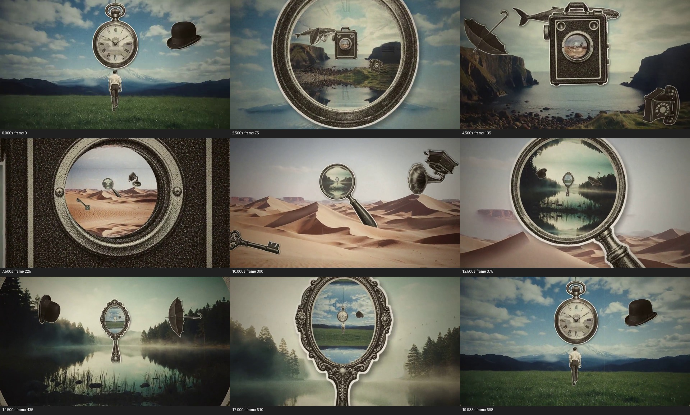
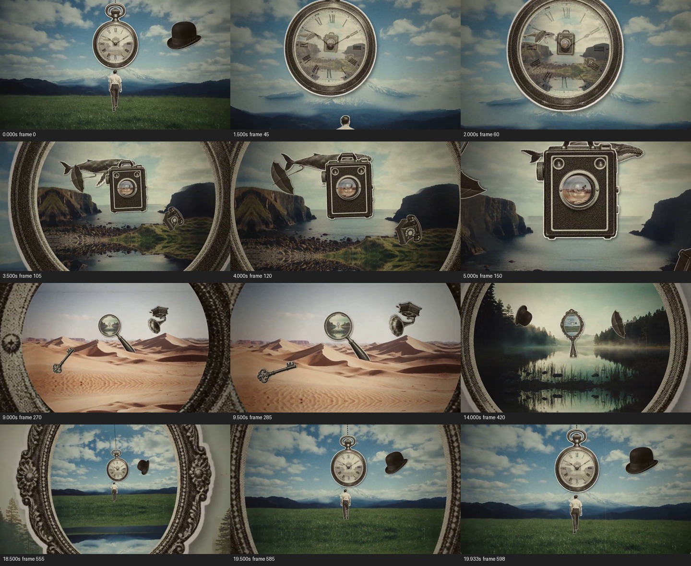

# 把下一处景观藏进旧物，让每次进入都交出下一扇门

来源：案例012《复古拼贴与镜头穿越》，署名 koldo2k；[来源页](https://skillry.dev/ai-videos/opus-5-5/koldo2k-778767)。

范围：完整原片 [0.000, 20.062) 秒。时间均指原片；切片内时间须减去 0.000 秒。

[完整原片](../video.mp4) · [本卡完整片段](../video.mp4) · [当前拆解总览](overview.md)

观察方式与限制：frame-only：本轮重新提取并观察全片每0.5秒源帧与末帧，另核对关键局部源帧。未完成原速连续观看、慢放播放或听审；不能确认采样间隔内的完整运动、原速节奏与声画同步。技术手段和外部素材来源未经作者工程核实。

本轮依据用户指定的《创意卡拆解指令·最终修订版》重新观察、重新写作；旧创意卡正文未作为底稿。当前文件是本ID在派生索引中的唯一正文入口，保留的旧文件不代表另一张当前卡。分析结论不是作者自述，也不是观众效果实验。

补充观察：本轮另核对19—19.8秒每0.2秒及首帧、第30帧、末帧；首尾对照显示回认，但不是同帧状态。

补充分镜源帧：0、45、60、105、120、150、270、285、420、555、585、598；源时间依次为0、1.500、2.000、3.500、4.000、5.000、9.000、9.500、14.000、18.500、19.500、19.933秒。

## 1. 原画面具体怎样设计

这是一段无画内说明文字的超现实拼贴。开头是带山脉和云层的绿色草地：一名背向观众的小人位于下方中间，巨大的怀表悬在他上方，黑色圆顶帽在右上。风景给出可进入的远近空间，旧物则明显超出日常尺度，边缘带有剪贴感。小人的作用是给最初的世界一个人的尺度；他并未被持续展示为带领观众走完整个旅程的主人公。

0—约4.3秒，视野不断靠近怀表，草地人物和帽子逐渐去到边缘。最初还能看到表盘和罗马数字，约1.5—2.5秒，海湾景观及一部旧相机开始在表盘区域内出现，钟面刻度让位；表壳仍围住内景，外侧也仍保留草地天空。到约3—4秒，观众同时看到“我仍在外部”和“那里已有另一个地方”。怀表继续变大，金属边缘越出画面，海湾成为新的满幅环境。

约4.3—9.8秒，海湾由两边岩壁夹住水面，一部带镜头的旧相机悬在中央；上方横着鲸，左侧有雨伞，右下有电话。它们不是一组等待阅读的分类标签，而是围绕中央入口的黑白拼贴陪体。中央相机越来越大，鲸、伞、电话随相对尺度和位置变化向边缘退出。相机镜头很早就能看见暖色沙丘，镜头的圆框、机身皮革纹理和两侧海湾先共存，然后机身被放大到越界。观众穿过的是已看见的沙漠图景，不是先看一个空镜头、黑屏之后才知道目的地。

约9.8—14.5秒，沙漠接管全幅，沙丘的明暗脊线形成有层次的前景。左下是钥匙，右上是留声机，中央偏上立着带柄的放大镜。放大镜内并非放大的同一片沙，而是有树林、雾和水面倒影的冷绿色湖景；里面还可辨出下一件带柄手镜。视野靠近放大镜，柄向右下延伸并逐渐越界，钥匙和留声机离开中心观察区。圆框中的湖面越来越大，沙漠作为外部环境逐步退到镜框周围，最终被接管。

约14.5—19.933秒，湖景满幅，树林与倒影把水平中线和中央通道建立起来，圆顶帽和雨伞分处两侧，中央换成花纹细密、椭圆镜面的手镜。手镜内部提前出现蓝天、绿色草地、悬空怀表及小人。向手镜靠近时，镜柄与繁复边框先给出物件身份，随后边框成为两侧越来越宽的近景，向边缘退出；开场的草地—人物—怀表—帽子组合重新占据主画面。最后一帧为源第598帧，19.933333秒；视频流至19.966667秒，音轨到20.061995秒。首尾能回认同一套场面，但怀表大小、人物位置和帽子姿态并不完全相同，因此不认定为无缝循环。

整段的可见顺序是“当前风景—风景中的旧物—旧物里面已存在的下一风景—下一风景的中央旧物”。这四层关系不断交接：当前旧物提供近处边框，内部风景提供目的地，新风景中的另一个物件提前成为下一次注意目标。观众不必每次重新搜寻入口，外围道具的离场则留出主要通道。画面并不解释怀表、鲸、钥匙各自的象征意义；本轮也没有依据把它们写成时间旅行、记忆或因果故事。是否存在旁白、音乐或配合穿越的音效未听审，不能从视觉节奏倒推声音设计。

## 2. 为什么这样设计，好在哪里

主创意是让“装着景观的物件”在靠近过程中变成“观众即将身处的环境”，并在这个新环境里继续留下另一个入口。观看价值来自关系的翻转：刚才只是表盘里的一小块海湾，接下来成了四周；刚才是海湾中央的相机，其镜头又容纳一片比机身宽广得多的沙漠。每次抵达同时提供下一次探索的线索，几轮之后，手镜里认出草地与怀表，形成对开头的回认。只保留某一次圆形放大，会保存局部转场，却失去连续探索和末段回认的整体价值，因此本片保留为一张卡。

材料的选择在这里是结构条件。怀表有表壳与表盘，相机有机身与镜头，放大镜有柄与圆形镜面，手镜有装饰边框和镜面；它们都提供“外部能认出是某件物品、内部能容纳另一场景”的两层结构。开头表盘并不是天然空洞，而是先让内景进入表盘区域、替掉刻度，因此更准确的说法是物件的观看面被重新用作入口。若只用四个任意圆圈，几何穿越仍可完成，却失去了物品身份与内部世界之间的超现实反差。

景观也有具体作用。海湾的岩壁、水道，沙漠的沙丘脊线，湖景的树线、倒影，都在中央物件周围保留了可识别的环境；冷暖色和地貌变化让观众知道自己已经换了地方。黑白旧物和较有颜色的风景区分前后材料，细边和纹理在放大中持续说明边框属于什么。外围鲸、伞、电话等丰富各个空间并让尺度变化可见；它们并不是每一件都不可替换，更不能为每个道具另造一张创意卡。

持续靠近、内外景共存和提前露出下一入口是关键支撑。若内部一直不出现下一风景，推近就只是物件特写；若下一景直到切换后才出现，关系会变成普通换景；若外围道具和中心入口同样抢眼，观众会失去稳定的观察方向。循环回认增加整段形式上的完整感，但这不等于帧级循环已对齐。具体黄旧质感、怀表型号、景观地点与边框花纹可以替换；是否使用三维摄像机、嵌套平面、遮罩缩放或其他方式，无法从本轮源帧确定。抽帧能确认尺度和状态顺序，不能证明连续推进的速度曲线、惯性或无顿挫观感。

## 3. 可直接使用的创意指令

用于需要观众经历一串空间，而不是停下来读大量信息的段落。先确定希望经过的少量环境及其观看差异，再为每个环境选择一件有清楚外轮廓、内部观看面和足够可见面积的物品。不要先挑几个酷炫转场再塞景观；物件的内部区域必须能装下下一环境的主要识别特征，而且扩大后有足够画质成为满幅。下一景中还需为下一件入口物留位置，不能抵达之后才突然补出毫无准备的目标。

入口先用完整环境和可辨物件建立尺度，让观众知道自己在哪里、要靠近什么；随后在物件内部显露下一环境，保留物件边缘与外部环境共存的一段，让“里面”和“外面”这层关系被看懂。让前进的视线持续指向已经露出的入口内部，内部景观扩大，外部边框逐渐越出，同时让陪体向外围让位；不让外围道具突然取代入口成为新的追踪目标。入口不必严格居中，路径也不必完全直线。接管满幅后，不要停在没有目标的空景；让此前已见到的下一入口继续取得主位，沿同一规则推进。每一轮都必须经历认物、见内景、进入内景这三个作用，时长按物件复杂度和新景辨认难度调整，不继承原片秒数。首次可给更多认识窗口，后续在规则成立后适当加快；实际速度必须在连续播放中再判断。

结构迁移的例子是一个“不同阅读世界”的视觉段落：书桌上的放大镜先显露地图中的港湾，港湾中央的望远镜镜片提前露出星空，星空中的舷窗再露出书桌。放大镜、望远镜、舷窗分别承担原片表盘、镜头、手镜的入口功能；地图海岸、星群和桌面物品承担环境识别，最后回到先前可认的桌面构图。它只是一种有条件的设计映射，需另备可用素材，不能声称是真实地理连续穿行。若题材要求准确的空间关系，例如建筑导览，入口后的场景必须有真实对应，不能用这套超现实结构伪造相邻关系。

必须保留的是入口身份、内景预先可见、内外景的共存阶段、接管后的下一目标以及全段一致的观察方向；不必保留复古外观、四次穿越或所有外围道具。想做回环时，最后入口里先放回开头可认的场面；若还要技术上的无缝循环，则另行对齐首尾状态与速度并连续播放检查，不能凭“回到了草地”判定通过。缺少可放大的内景、入口过小无法辨认、各场面没有视觉差异，或文字必须稳定阅读时，应减少层数、改变任务组织或放弃持续穿越。

迁移验证状态：**原片拆解（frame-only，连续观看验收未完成）**。未制作新题材样片，未验证迁移效果。
