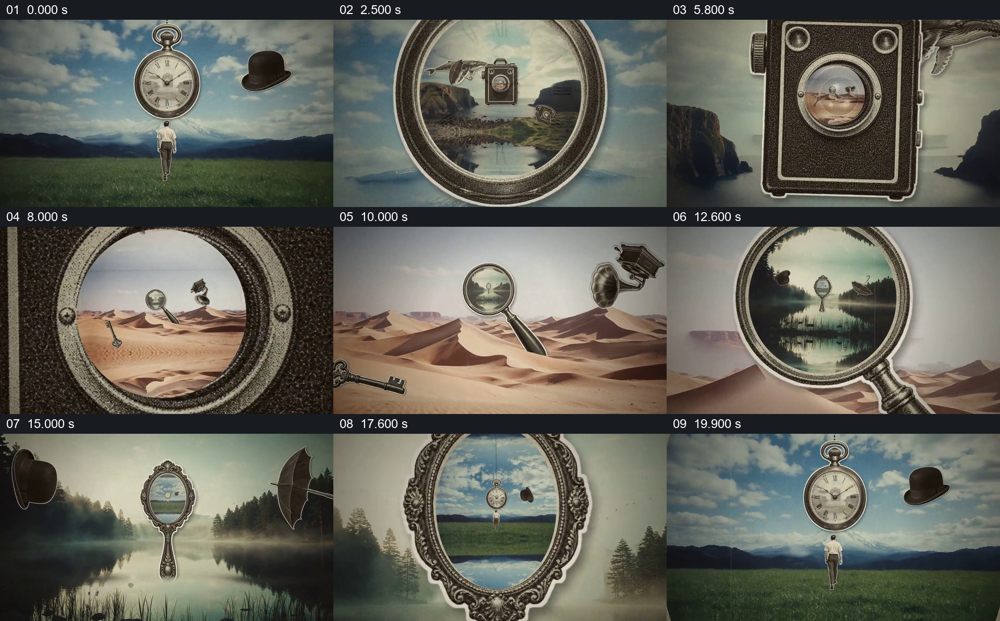

# 从怀表进入相机、放大镜和镜子里的世界

- 作品：案例 012《复古拼贴与镜头穿越》（索引名称）。
- 原片范围：00:00.000–00:20.062，含起点、不含终点；[完整原片](../video.mp4)｜[本卡片段](../video.mp4)。
- 观察方式：依据整片 64 宫格和约每秒一次的真实源帧观察，未连续原速观看或听审；声音、语气与完整播放节奏未确认。

## 原画面具体怎样设计

草地上人物面对悬浮怀表与礼帽；视野靠近怀表，表面内出现海岸和相机。相机逐渐居中，其镜头内部先能看见沙漠；镜头变大后沙漠铺满画面，沙地里出现放大镜。镜片里预先显出湖面景观，放大镜扩张并接管画面；湖面中央的装饰镜子又显示最初的草地、人物和怀表，镜框扩大后回到开场构图。

## 为什么这样设计，好在哪里

每个下一地点先被限制在一个能识别的开口里，随后才扩大为环境，因此不同素材之间有可跟随的视觉位置。怀表、镜头、放大镜和镜子不是四个无关遮罩，而是反复承担“先预见、再进入”的角色，末尾返回开场形成回环感。

以上为依据画面的分析，非作者自述；预期观看效果未经观众测试。

## 可直接使用的创意指令

当希望观众以探索方式经历多个空间，且每个目的地都有能承接下一景的对象时，先在当前场景建立一个可辨的圆形或其他明确开口，让下一景在其中提前出现；继续推进并使边框逐步离开画面，让原先的局部成为新环境，再在新环境中建立下一处开口。保持每次进入的对象与方向清楚，末尾若需要回到开场，应核对前后构图是否可接；图像真实性和连续运动须按实际素材验证。
