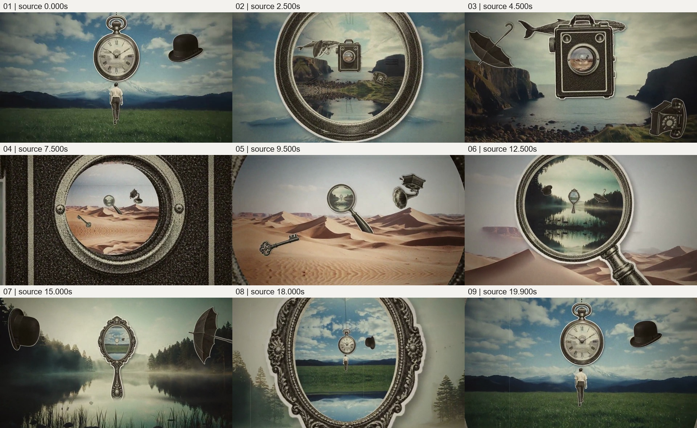
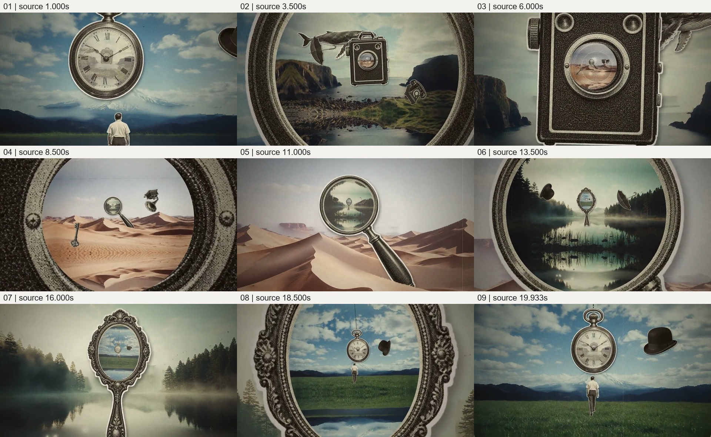

# 把下一世界提前藏进物件内部，让连续穿越最终回到首景

来源：012《复古拼贴与镜头穿越》，作者 koldo2k；[来源页面](https://skillry.dev/ai-videos/opus-5-5/koldo2k-778767)。

完整原片：[012 原片](../video.mp4)；本卡片段：[观看片段](../video.mp4)。

范围：原片 [0.000, 20.062) 秒，起点包含、终点不包含。

观察方式：本次核看完整原片的 64 帧总览和本卡九宫格，正文沿用此前已整理的案例创意卡，并对照上述源帧；并非本次从零重做全部观察。原卡记录了此前浏览器原速播放时的连续截图、全片每 0.5 秒源帧及关键交接加密取帧，该历史记录不冒充本轮操作。

观察限制：本次未独立完成连续原速观看；历史截图序列也不能等同逐帧连续观看。本次未实际听审，不判断音乐、音效或声画卡点。素材来源、制作技术和界面功能真实性未确认；下述迁移方法尚未在新作品中验证。

## 原画面具体怎样设计

开场是草地、远山和蓝天云层，背向观众的人站在下部中央，巨大怀表悬在他上方，黑礼帽浮在右侧。人物与景观的尺度较日常，怀表和帽子的尺度与悬浮状态却不合常理。怀表有罗马数字、指针和金属外缘，作为物件能够先被辨认；视点向它靠近，人物向下出画，帽子移向外围，表盘内部开始显出下一处景观。

约 2–4 秒，怀表里面已能看见岩岸海湾，中央悬着复古方形相机，周围有鲸、雨伞与电话。表壳扩大为画面前景的环形边界，旧草地被挤到外侧，再随着表框离开而退出；海湾成为整个外部环境，相机接替怀表成为前进目标。新场并非等表框消失才突然出现，它在仍属于“表内画面”时就已经成立。

约 4.5–9 秒，相机越来越大，黑白细纹机身占据更多画面。圆形镜头中提前露出暖棕沙丘，沙丘中又有放大镜，旁边是钥匙和留声机。靠近镜头时，金属圆边逐渐成为画面边缘，镜头内的沙漠接管全屏，海湾和相机外壳离开。进入沙漠后，斜柄放大镜仍位于前进路线附近，前后起伏的沙丘把它与外围道具分出距离。

约 10–14.5 秒，视点接近放大镜，镜片内出现绿树围绕的湖面与倒影，湖中轴线上又立着一面小手镜。放大镜圆框逐渐变大，沙漠退到四周，直到湖泊成为外部环境。约 15 秒，装饰性椭圆手镜处在画面中间，礼帽和雨伞分处左右；树林与水面倒影使中央路线仍然容易辨认。

最后一次靠近手镜时，镜中不是另一片陌生风景，而是开头的蓝天草地、背向人物、悬浮怀表和礼帽。花纹镜框逐渐扩大，湖泊退出，接近片尾时重新回到草地景物组合。已观察到首尾内容的呼应，但不能据此认定重播接缝无跳变或精确无缝循环；视频末帧约在 19.933 秒，容器及音轨延续到约 20.062 秒。

补充分镜源时间：1.000、3.500、6.000、8.500、11.000、13.500、16.000、18.500、19.933 秒。与主九宫格合看，可辨认每个旧物件的内部区域、新环境和下一入口同时存在的阶段。

全片没有依赖解释字幕或界面文字建立路线。旧物件呈黑白或褐黑细线纹理，有浅色切边，环境呈低饱和照片质感；这只是可见外观，不能据此认定素材来源或制作方法。草地蓝绿、海湾灰绿、沙漠暖棕、湖泊深绿的变化使不同世界容易区分，物件相近的旧式质感又把它们联成一组。连续推进的趋势可见，精确速度变化、摄影机实现及声音参与方式未知。

## 为什么这样设计，好在哪里

主创意不是四次推近，而是让“当前物件的内部”提前成为“下一世界的外部”，并在目的地里再放置新的入口。观众先认识一个熟悉的物件，随后发现它不只是物件；接近它既扩大细节，也兑现进入另一处空间的预期。这种关系反复建立后，下一枚小镜头或小镜子会自然成为值得继续看的对象，整段形成持续的发现过程。

怀表、相机、放大镜与手镜并非只因轮廓大致圆就能互换。它们分别有可识别的表盘、镜头、镜片和镜面，有明确的边界及内部可展示区域；它们又与计时、记录、观察、映照等日常经验相联。原片利用这些结构，把不可能的空间放进熟悉的容器。若只有一个无名圆孔突然放大，穿越还能发生，却会失去“认识旧物—发现内部异常—进入新世界”的认知变化。

每一轮都保留两个关键中途状态：一是旧环境中的载体已经足够清楚，内部的新环境也开始可见；二是旧框仍围在前景，新环境里下一载体已经建立。前者让空间转换有入口，后者让当前穿越和下一次探索接上。删掉其中任一步，容易变成带圆形边缘的普通换图。这里所谓纵深来自片内的大小、遮挡和内外接续，不要求判断为真实三维拍摄。

中央目标持续接力，外围道具则提供尺度变化、离场参照和超现实氛围。人物衬出怀表的异常大小，鲸、电话、钥匙、留声机等让每层景观有差异，但没有接替中央路线成为新的停留目标。边框越接近越大，外围物件向外离开，背景被新的内部画面取代；构图、素材形态和推进动作共同说明“我们正在进入这个东西”，而非单靠镜头术语制造空间感。

四次穿越合在一起才建立递归规则，尾部回到开场又把探索折回起点，所以保留全片为一个创意单元。若拆成四张只更换道具的卡，会重复动作名称，并丢失规则的累积和结尾的回望。具体草地、鲸、旧电话以及褐色纹理属于可替换的题材与外观；下一世界提前可见、载体内外关系清楚、下一目标及时接力才是不可少的设计。循环只是本片的收束选择，不是所有迁移都必须复制的结论。

## 可直接使用的创意指令

当新内容需要带观众逐层发现关联、进入更小尺度或探索一组世界时，先决定每进入一层究竟多知道了什么。寻找与该层内容有真实联系、且具有可辨内部区域的载体：例如档案中的照片、仪器的观察窗、地图的局部或产品的结构开口。再为内部准备真正值得进入的材料；载体的形状、可读细节和目的地的构图共同决定入口，不先画一串圆孔再随意填图。

每一层先给旧环境和载体足够的辨认条件，再让内部提前出现目的地。靠近时保持入口位置可追踪，让旧边界逐渐成为前景，旧环境退到外围；在越界之前，内部就应具备足够清楚的新环境和下一目标。新环境接管全幅后，下一目标沿同一观看路线接手。可以采用圆、椭圆、窗口或不规则开口，关键是观众能看懂边界来自什么对象、为何进入这里。

让外围材料服务于每一层的含义与尺度，控制其面积、对比和出入方向，避免抢走下一入口的注意力。新场颜色、材质和景深感可以变化，但入口身份与内外关系要稳定；如果目的地细节复杂，就增加建立或停留，不以持续高速推进牺牲辨认。素材只有平面证据时，可以把穿越作为明确的视觉隐喻；不要把拼贴关系描述成证据本身存在的物理空间或事实因果。

直接迁移适合本就有多个观察窗口或嵌套图像的内容。结构迁移适合“整体—局部—内部机制”等解释，但每次深入必须带来新信息，并由真实材料支撑相邻层的关系。其他参考只补充某次边界交接或材质处理，不额外开出另一条没有内容依据的探索路线。

结尾按表达目标选择回到起点、揭示全部层级或落到一个新结论。回到起点时保留可识别的首景特征；若要做真正无缝重播，另行检查首尾构图、运动趋势及声音接缝，不能仅因道具相同就宣布循环成立。若层与层之间没有值得解释的联系、载体内部难以辨认，或推进只让信息越来越小，就调整层数与观察方式，必要时放弃穿越，改用能让材料充分被读懂的场景组织。
