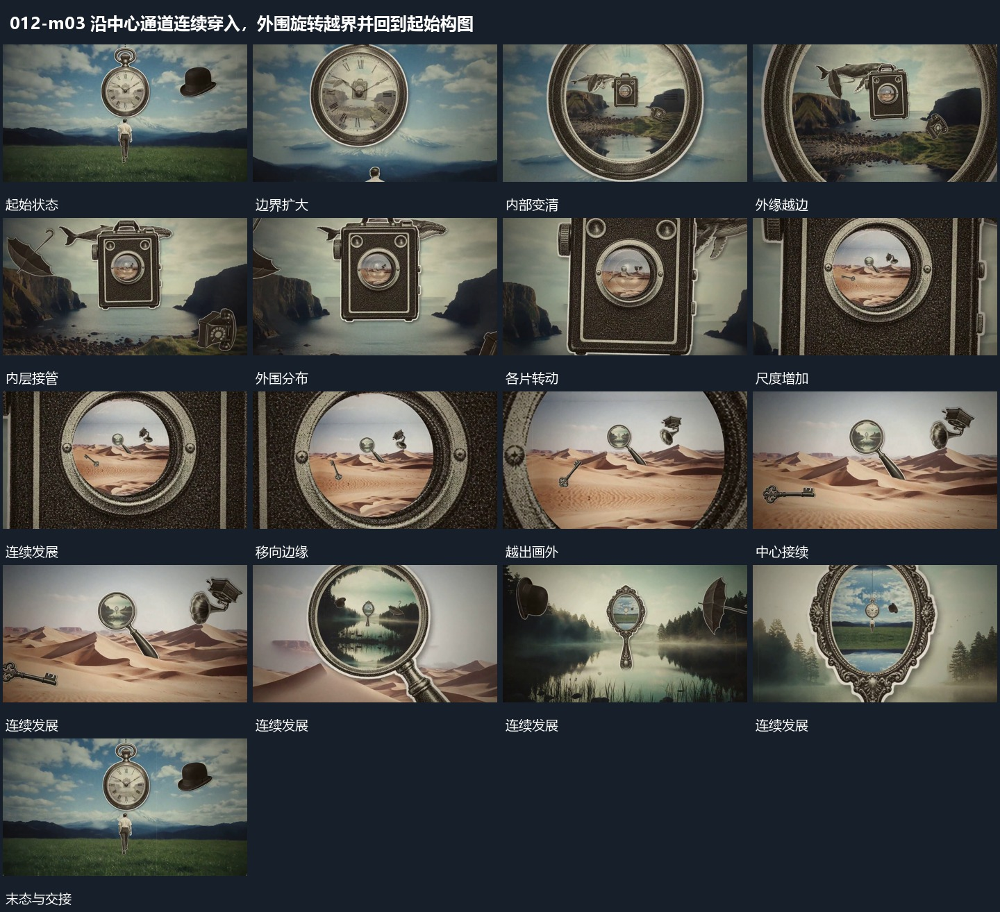

# 沿中心通道连续穿入，外围旋转越界并回到起始构图

## 运动指令

起始：中心有带边界的开口，内部已可看见另一层。。

1. 中心持续推进与外围旋转同时发生。

2. 上一内层变为满幅后继续穿入，最终回到接近起始的构图。

上述镜头变化与局部动作按同一条连续过程推进；写明同时发生的步骤在原场面中交叠，不先完成整段运镜再重演局部。

## 视频切片

[播放本机制的原片切片](m03.mp4)

保留起始准备、连续发展和完成或明确交接；首尾按本段运动范围裁切，不拼接、不变速。相连的小动作合为同一完整段落。

## 分镜过程

## 组合与调整

保留以下动作关系：中心持续推进与外围旋转同时发生；上一内层变为满幅后继续穿入，最终回到接近起始的构图。

可调整位移距离、层级间距、重复数量与相对快慢；已有锚点和未退出的层继续承接。连接下一段时以切片末态为起点，另行设计不连续的状态转换。
