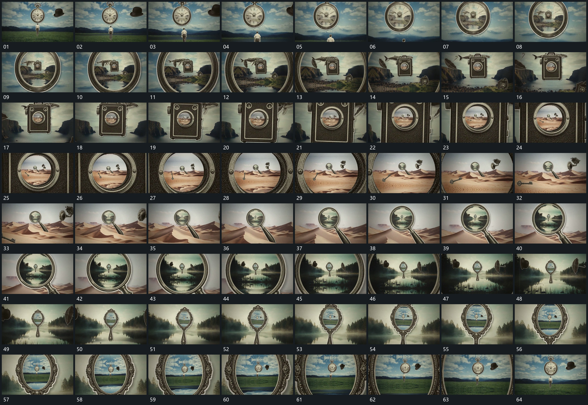

# 012｜原片运动总览

[观看完整原片](video.mp4)

## 运动总览

全片以 向中心开口持续推进，内层扩大成为下一场 为主：中心开口先露出下一层，向内推进后外缘越出，原内层成为新的整幅画面。进入后又遇到新的圆形或椭圆形入口，再重复推进，并非每次穿越都需要一条新机制。

推进期间 外围片层自转并向边缘越出，让出中心通道 与它交叠，外围片层旋转、放大、向边缘离场，使中心始终保持可进入的通道。几轮接管以后，最后一个开口里出现近似开场的布局；推进至片尾时回到这一构图。此处记录的是构图回归，不把它表述成已确认的无缝循环。

## 完整运动段落

以下按原片中的出现顺序引用。建立、内部发展及完成反馈放在同一段中；同时发生的局部动作与运镜写在同一份指令里。不同段之间可以是连续接管，也可以是直接切换，不能仅凭条目相邻认定可直接拼接。重复出现的同类运动采用一次连续代表范围，切片不以逐段无缝覆盖整片为目标。

1. [沿中心通道连续穿入，外围旋转越界并回到起始构图](mechanisms/m03.md)：中心持续推进与外围旋转同时发生；上一内层变为满幅后继续穿入，最终回到接近起始的构图。

切片保留起始准备、必要内部停顿和完成或明确交接；首尾省略无新发展的等待，持续运动不要求人为停住。以上基于真实源帧序列和重点边界核对，不等同于全片连续声画审片。

## 完整64宫格

