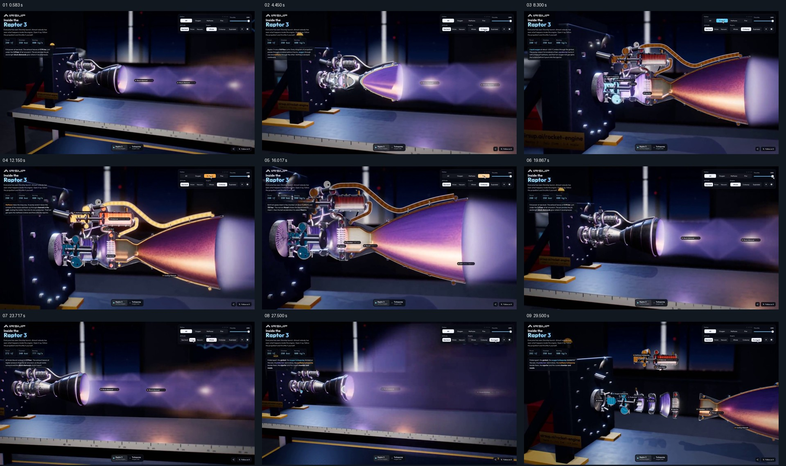

# 以同一运行状态对照外壳、剖面与拆解

- 作品：案例 099。
- 原片范围：00:00.000–00:30.300（源时间，含起点、不含终点）；[完整原片](../video.mp4)｜[本卡片段](c01-20261111.mp4)。从原片新截片段并制作分镜，末尾不包含新主题。片段起点对应原片 00:00.000。
- 观察方式与未确认范围：核看全片 64 帧总览和本卡九宫格；另核看源 27–32 秒约每 0.25 秒抽帧。未独立连续原速观看或听审，抽帧间运动、精确节奏、声音和同步未确认。价值判断为作品分析，跨项目迁移尚未实测。

## 原画面具体怎样设计

深色测试空间里，发动机固定在左侧支架上，喷口朝右，紫色喷流横穿画面；左上介绍和数值、右上状态选择与底部设备入口共同围住主画面。测试台、支架与喷流方向先建立这台机器的使用位置。

随后喷口出现剖面，接着发动机内部占据更大画面，管路、泵和燃烧区域以不同颜色及小标签区分；右侧仍延续同一方向的喷流。不同源帧中右上选项从全部变到氧、甲烷和火，左侧说明随显示内容变化，模型的位置、朝向和喷口仍是持续参照。之后外壳重新出现，画面回到较远的测试台视角，喷流的形状也有变化。

约 27.75 秒后，部件沿原先朝向分离：左侧支架与后部零件、中央若干环状构件和右侧喷口彼此拉开，末段可以同时看见它们的排列。30.3 秒结束于拆解结果；原片随后转向另一台部件，本卡不将其并入。

## 为什么这样设计，好在哪里

先给观众看得见的喷流，再在相同支架和喷口方向上显露内部，可以将复杂的管路和部件与外部现象对应；颜色与标签把注意力从整个发动机依次引到不同内部区域。回到外观后再分离零件，让观众在已经认得整体的条件下看组合关系。

这是对视觉安排的分析；画面属于模型与界面演示，数值、材料流向及喷流形状没有工程核验。

## 可直接使用的创意指令

适用于说明一个装置的运行外观和内部结构。先准备同一设备的外部、剖面和部件资料，固定观察方向及一个环境参照；把可见的工作结果放在主体旁，再逐层揭开内部，用少量标签标示有依据的关键部件。回到整体后，按原有连接次序分离部件，使观众能从整体、内部和零件三种观察中认出同一对象。

可以改变介质、环境、色彩和剖开方式；要保留设备方位、部件对应与可辨的外部结果。模拟画面应注明示意，不能把虚构管路或数值当作工程证据。
