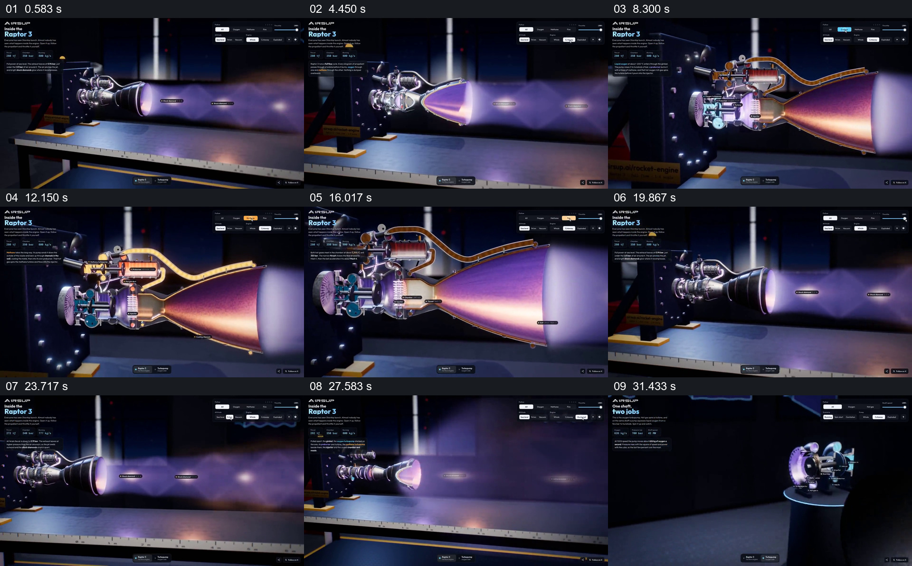

# 让运行外观与内部剖面对应，再分开部件

- 作品：案例 099《火箭发动机的外观与剖面》（本次概括）。
- 原片范围：00:00.000–00:34.700，含起点、不含终点；[完整原片](../video.mp4)｜[本卡片段](../video.mp4)。
- 观察方式：依据约每秒一次的真实源帧观察，未连续原速观看或听审；声音、语气与完整播放节奏未确认。

## 原画面具体怎样设计

深色界面中发动机对着试验台喷出紫色尾焰，标签落在喷流附近；外壳渐渐显示内部剖面，橙色管路和内部构件沿发动机展开。画面返回完整外观后，尾焰与喷口变化，发动机部件分离，随后切到独立机械模型及标题。

## 为什么这样设计，好在哪里

外部喷流先给剖面一个工作状态参照，保持相近的方向和位置使内部与外部可对应；拆开部件则突出组合关系。运行过程和具体部件功能是画面示意，未经工程核验。

以上为依据画面的分析，非作者自述；预期观看效果未经观众测试。

## 可直接使用的创意指令

解释机械装置内部结构时，先展示完整外观与可见运行状态，再以同一方向切入剖面，清楚标注实际部件和流动路径；若拆解部件，应保留它们原本的相对位置，并区分示意动画与真实实验。
