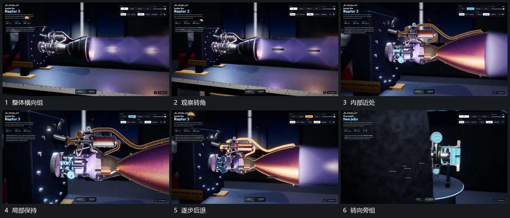

# 围横向组形转角推近再退回

## 运动指令

围横向组形缓慢改变观察角度，同时向目标局部靠近，近侧支架与端部先后越界。局部完成后后退露出整组，再向旁侧另一小组转向；各组仍留在同一场面，近远变化有连续参照。

## 视频切片

[播放本机制的原片切片](m01.mp4)

覆盖分镜中“整体横向组”至“转向旁组”的连续过程，并保留邻近的前后衔接画面；原片中交叠发生的动作一并保留。

## 分镜过程

## 组合与调整

可只用推退；旁组接管前先露出其所在方向，不突然把对象搬到另一空间。
