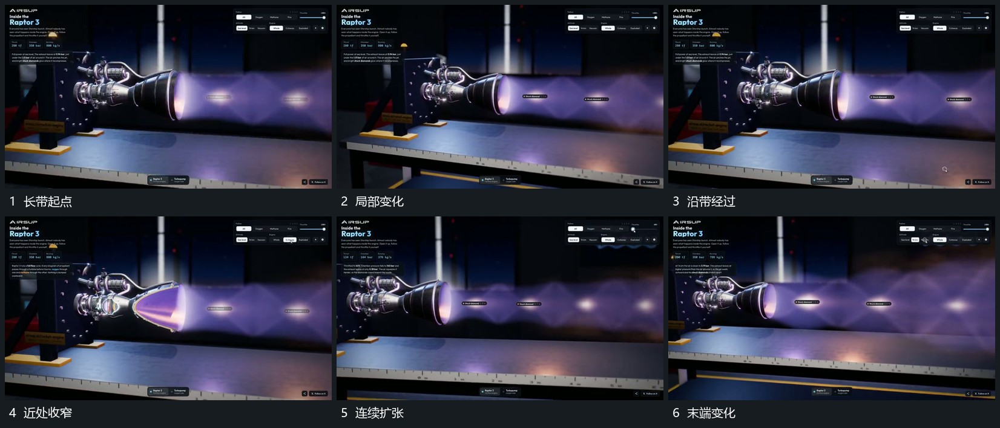

# 固定开口送出带状层局部反复收窄扩张

## 运动指令

保持开口位置，从该处持续向侧方送出长带。带内局部先收窄再扩张，变化沿长度方向向外经过，远端继续延长或退弱；底层支架不随带的变化伸缩。

## 视频切片

[播放本机制的原片切片](m02.mp4)

覆盖分镜中“长带起点”至“末端变化”的连续过程，并保留邻近的前后衔接画面；原片中交叠发生的动作一并保留。

## 分镜过程

## 组合与调整

可用抽象条带，不要求流体模拟；先明确传播方向再加入局部形态变化。
