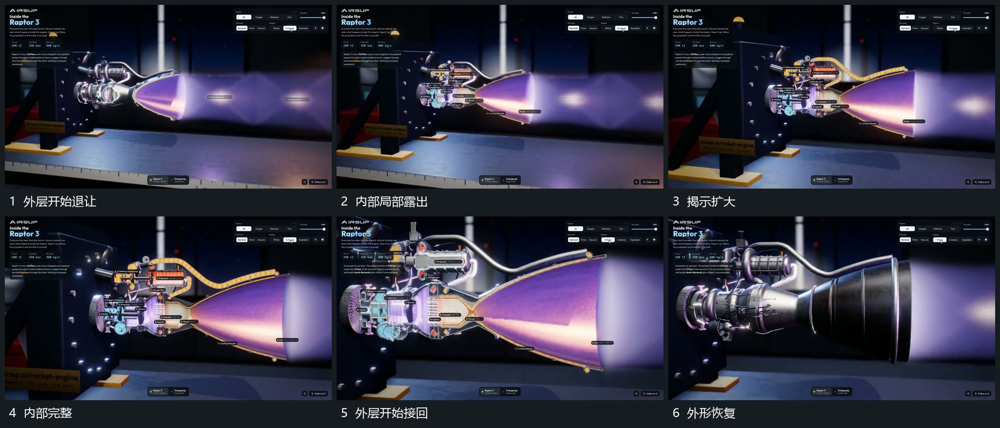

# 近侧外层逐步退让露出内部再合回

## 运动指令

保留远侧轮廓，近侧外层从局部开始退让，露出内部同轴结构，揭示范围沿组延长。内部可见后保持支架和端点，完成观察再让外层沿原位置接回；长带在揭示和合回中持续。

## 视频切片

[播放本机制的原片切片](m03.mp4)

覆盖分镜中“外层开始退让”至“外形恢复”的连续过程，并保留邻近的前后衔接画面；原片中交叠发生的动作一并保留。

## 分镜过程

## 组合与调整

不要推定原片使用切面还是透明层；新片选择可实现的方式保持同一前后状态。
