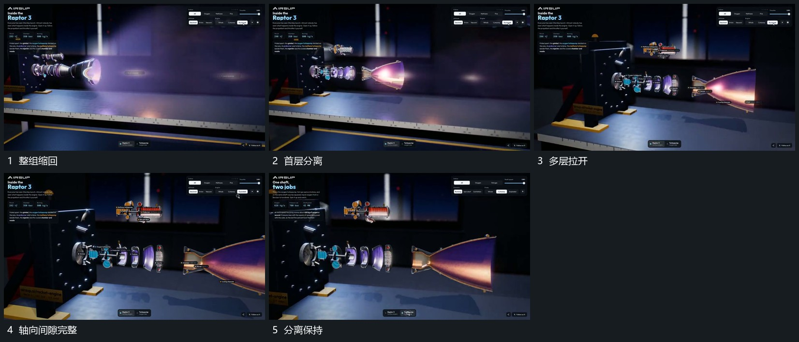

# 同轴圆片与端部沿轴向逐层拉开

## 运动指令

固定共同轴，把各圆片与端部沿轴向先后拉开，原排列顺序保持。间距逐步增加，内部侧支可以向上抬离，让主要轴线上每层可辨。外部带状层仍从端部方向持续经过，分离后暂时保持。

## 视频切片

[播放本机制的原片切片](m04.mp4)

覆盖分镜中“整组缩回”至“分离保持”的连续过程，并保留邻近的前后衔接画面；原片中交叠发生的动作一并保留。

## 分镜过程

## 组合与调整

层数与间距按需要调整；不能为腾空把层的前后顺序打乱。
