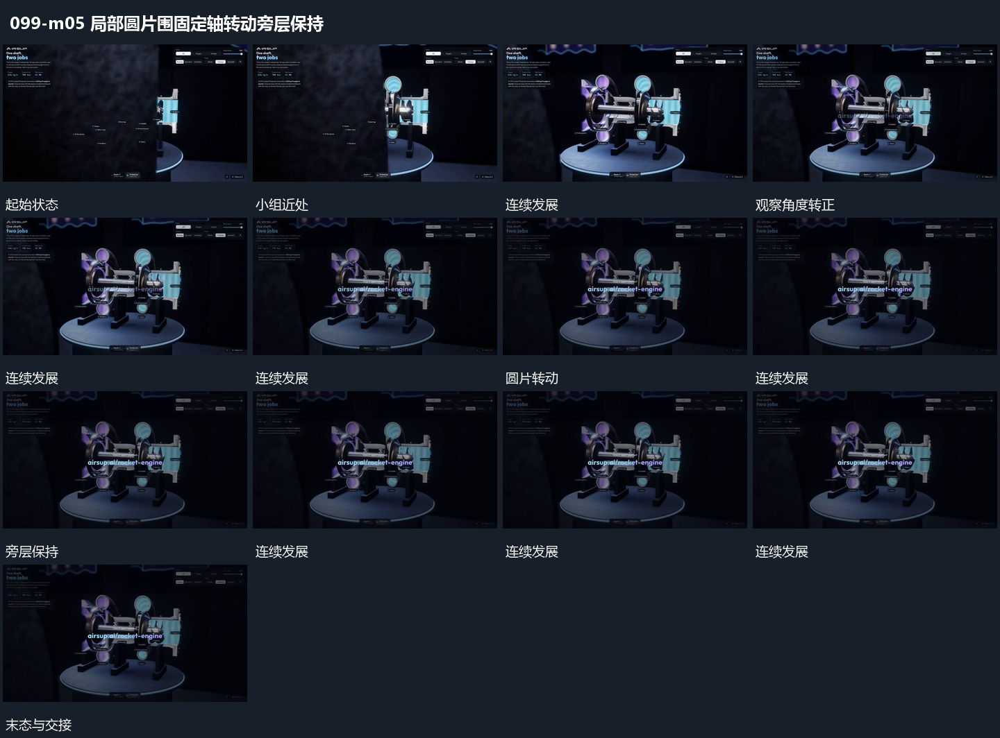

# 局部圆片围固定轴转动旁层保持

## 运动指令

让小组内圆片围各自固定轴改变角度，圆片附属短片随圆一起经过。支架、旁侧竖层与底部承载面保持，取景可小幅转角后停稳，局部转动继续作为收尾。

## 视频切片

[播放本机制的原片切片](m05.mp4)

覆盖分镜中“小组近处”至“局部持续”的连续过程，并保留邻近的前后衔接画面；原片中交叠发生的动作一并保留。

## 分镜过程

## 组合与调整

不反推真实转速与传动关系；可用纯几何局部保留相对运动。
