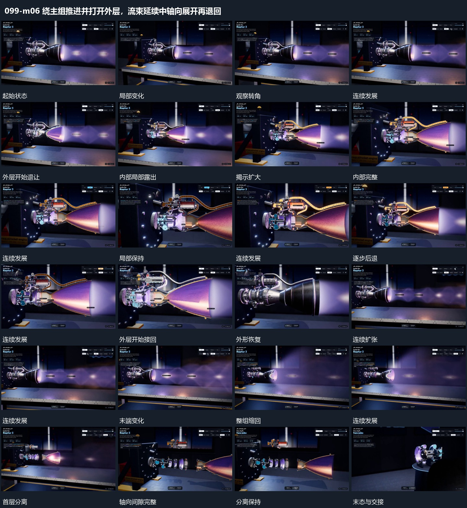

# 绕主组推进并打开外层，流束延续中轴向展开再退回

## 运动指令

起始：完整横向组形位于场面中。

1. 围绕主组转角推进时开口流束持续活动，近侧外层逐步退让显出内部再合回。

2. 沿轴把圆片与端部逐层拉开，取景退回完成整体展开。

上述镜头变化与局部动作按同一条连续过程推进；写明同时发生的步骤在原场面中交叠，不先完成整段运镜再重演局部。

## 视频切片

[播放本机制的原片切片](m06.mp4)

保留起始准备、连续发展和完成或明确交接；首尾按本段运动范围裁切，不拼接、不变速。相连的小动作合为同一完整段落。

## 分镜过程

## 组合与调整

保留以下动作关系：围绕主组转角推进时开口流束持续活动，近侧外层逐步退让显出内部再合回；沿轴把圆片与端部逐层拉开，取景退回完成整体展开。

可调整位移距离、层级间距、重复数量与相对快慢；已有锚点和未退出的层继续承接。连接下一段时以切片末态为起点，另行设计不连续的状态转换。
