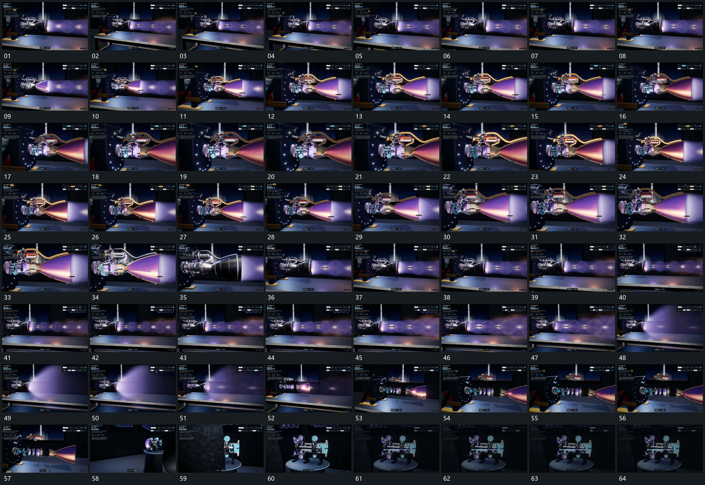

# 099｜原片运动总览

[观看完整原片](video.mp4)

## 运动总览

全片围同一横向组形，以围横向组形转角推近再退回小幅转角与推退观察。固定开口送出带状层局部反复收窄扩张在固定开口处持续送出向侧方延长的带状层，沿带周期出现局部收窄和扩张。

内部段落近侧外层逐步退让露出内部再合回逐步退让近侧外层，露出同轴结构，再把外层接回。末段同轴圆片与端部沿轴向逐层拉开把同轴多个圆片和端部沿轴向拉开，原带状运动继续；随后围横向组形转角推近再退回转向旁侧小组，局部圆片围固定轴转动旁层保持让其局部圆片围各自轴持续转动，结束在近处保持。

## 完整运动段落

以下按原片中的出现顺序引用。建立、内部发展及完成反馈放在同一段中；同时发生的局部动作与运镜写在同一份指令里。不同段之间可以是连续接管，也可以是直接切换，不能仅凭条目相邻认定可直接拼接。重复出现的同类运动采用一次连续代表范围，切片不以逐段无缝覆盖整片为目标。

1. [绕主组推进并打开外层，流束延续中轴向展开再退回](mechanisms/m06.md)：围绕主组转角推进时开口流束持续活动，近侧外层逐步退让显出内部再合回；沿轴把圆片与端部逐层拉开，取景退回完成整体展开。

2. [局部圆片围固定轴转动旁层保持](mechanisms/m05.md)：局部转动底层保持

切片保留起始准备、必要内部停顿和完成或明确交接；首尾省略无新发展的等待，持续运动不要求人为停住。以上基于真实源帧序列和重点边界核对，不等同于全片连续声画审片。

## 完整64宫格

