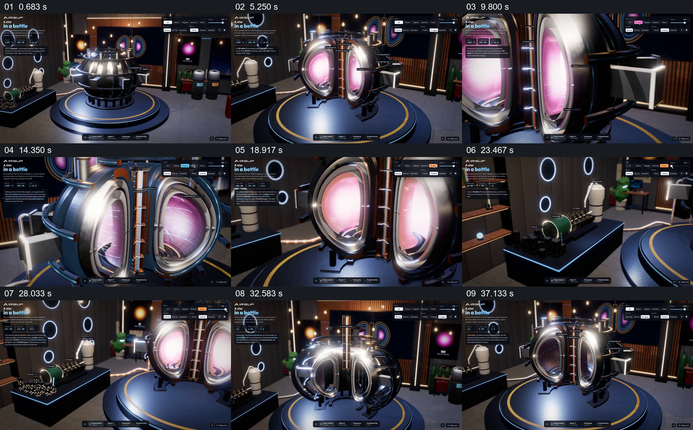

# 用稳定装置和界面观察内部状态变化

- 作品：案例 101《装置模型的状态与局部观察》（本次概括）。
- 原片范围：00:00.000–00:41.000，含起点、不含终点；[完整原片](../video.mp4)｜[本卡片段](c01.mp4)。
- 观察方式：依据约每秒一次的真实源帧观察，未连续原速观看或听审；声音、语气与完整播放节奏未确认。

## 原画面具体怎样设计

实验室内球形金属装置置于圆台，左侧和顶部保留控制文字与参数；装置分开后露出发光的粉色内部，视点靠近环形开口并绕其观察，参数选项和内部色彩变化。随后视点移向旁边带圆筒和线缆的装置，再回到球形整体，内部亮灭变化。

## 为什么这样设计，好在哪里

固定实验室和圆台提供空间参照，打开的外壳与稳定界面让内部状态及参数变化同属一个对象。画面为交互或模型展示，参数与物理效果未核验。

以上为依据画面的分析，非作者自述；预期观看效果未经观众测试。

## 可直接使用的创意指令

介绍可调设备时，先建立完整装置及可辨控制项，再显示内部状态与参数改变之间的实际对应；靠近局部后回到整体并交代与周边设备的连接。设备模型、参数与表现应依据真实资料或标注为示意。
