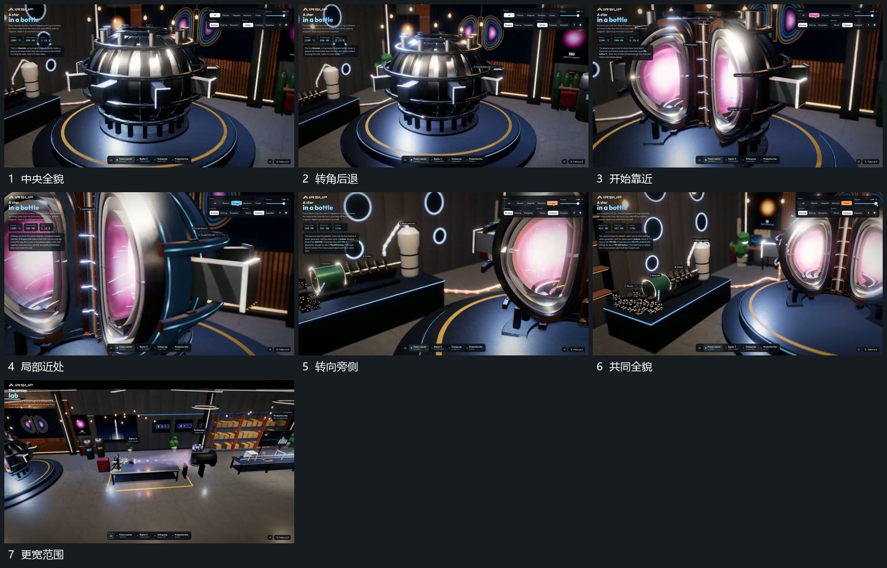

# 围中央组转角靠近再退到共同全貌

## 运动指令

围中央组小幅改变观察角度，靠近时让侧面边界逐步越界，近侧层经过幅度较大。需要观察旁侧时沿同一空间转向，中央组保留于边缘；完成后退回共同全貌，再露出更多周边组。

## 视频切片

[播放本机制的原片切片](m01.mp4)

覆盖分镜中“中央全貌”至“更宽范围”的连续过程，并保留邻近的前后衔接画面；原片中交叠发生的动作一并保留。

## 分镜过程

## 组合与调整

运镜先有目标局部，少做无目的绕行；旁侧接管保持空间方向。
