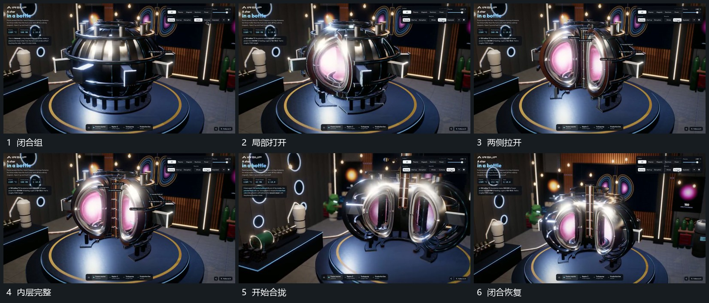

# 曲面外层向两侧拉开露出内层再合拢

## 运动指令

从中央分界处把曲面外层向两侧拉开，外层同时少量转角，使内侧面逐步可见。中间细长层保持位置，内部活动从间隙中露出。关闭时沿原方向反向靠拢，直到两侧接合；需要再次打开可复用同一过程。

## 视频切片

[播放本机制的原片切片](m02.mp4)

覆盖分镜中“闭合组”至“闭合恢复”的连续过程，并保留邻近的前后衔接画面；原片中交叠发生的动作一并保留。

## 分镜过程

## 组合与调整

开合保持同一外层身份，中心参照不动；不继承原装置的用途解释。
