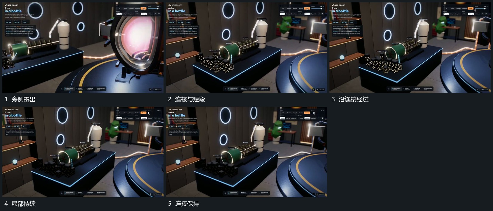

# 沿共同连接让短段依次经过原结构保持

## 运动指令

保留旁侧小组与曲线连接，让短段从连接一端依次向前经过，转弯处沿既有曲线改变方向。短段通过后连接本身仍在，另一批沿同方向接续；中央组在边缘保持，取景不为每次经过重置。

## 视频切片

[播放本机制的原片切片](m04.mp4)

覆盖分镜中“旁侧露出”至“连接保持”的连续过程，并保留邻近的前后衔接画面；原片中交叠发生的动作一并保留。

## 分镜过程

## 组合与调整

可用点或短片替代短段；连接是固定路径，经过层不应随机跳接。
