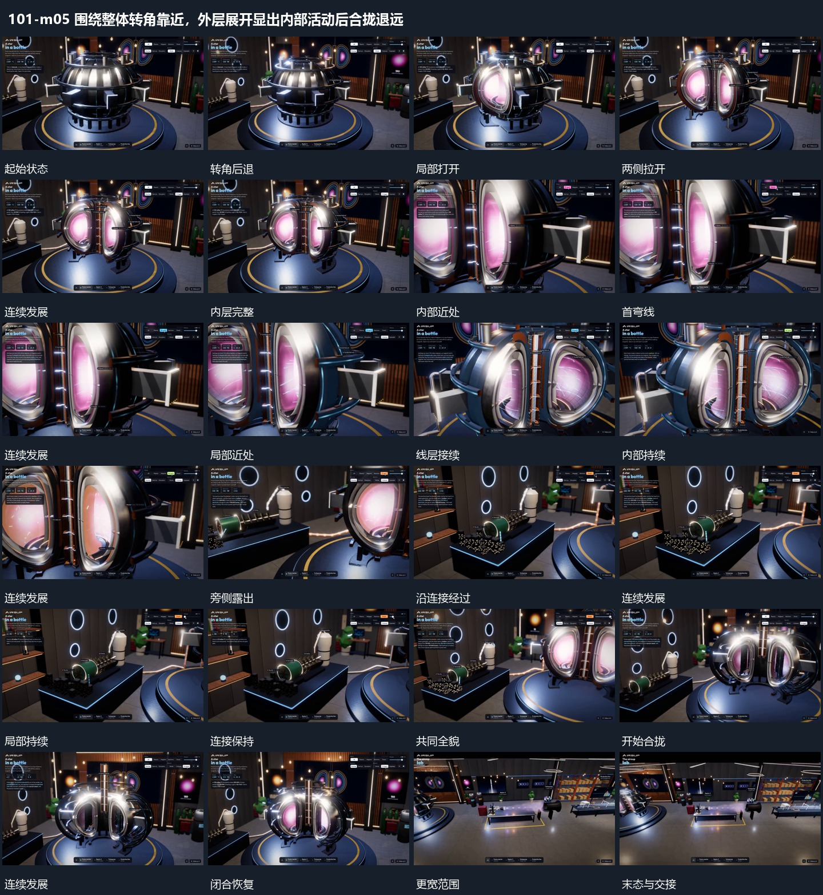

# 围绕整体转角靠近，外层展开显出内部活动后合拢退远

## 运动指令

起始：中央组完整。

1. 观看范围围绕共同中心转动并靠近，曲面外层向两侧打开。

2. 内部细线绕行时取景移向相邻连接，短段沿连接依次经过。

3. 随后回到中央，外层合拢，退镜恢复整体。

上述镜头变化与局部动作按同一条连续过程推进；写明同时发生的步骤在原场面中交叠，不先完成整段运镜再重演局部。

## 视频切片

[播放本机制的原片切片](m05.mp4)

保留起始准备、连续发展和完成或明确交接；首尾按本段运动范围裁切，不拼接、不变速。相连的小动作合为同一完整段落。

## 分镜过程

## 组合与调整

保留以下动作关系：观看范围围绕共同中心转动并靠近，曲面外层向两侧打开；内部细线绕行时取景移向相邻连接，短段沿连接依次经过；随后回到中央，外层合拢，退镜恢复整体。

可调整位移距离、层级间距、重复数量与相对快慢；已有锚点和未退出的层继续承接。连接下一段时以切片末态为起点，另行设计不连续的状态转换。
